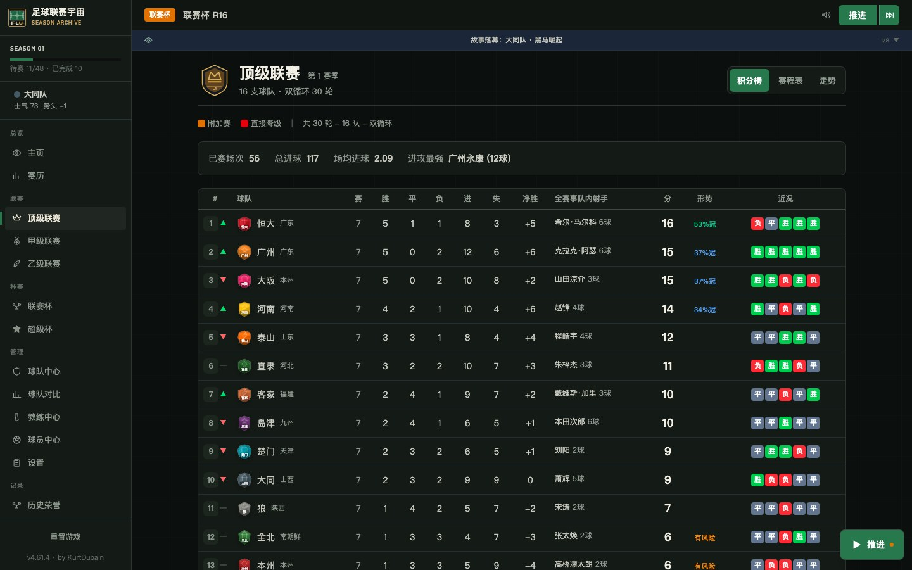

<p align="center">
  
</p>

<h1 align="center">下一季见：足球编年史</h1>
<h3 align="center">从一场球开始，跟一支球队过赛季。</h3>

品牌更名的本地验收与技术身份保留范围见 [品牌说明](docs/brand-rename.md)。下方旧版本截图作为历史演示保留，不代表新品牌最终参赛素材。

个人版与参赛版已分别部署，使用独立构建和存档命名空间，命令与资源边界见 [双版本构建](docs/build-editions.md)。三岸纪预设的人工内容审阅待办保留在内部清单，不代表授权或合规保证。

<p align="center">
  <strong>你不操控比赛 — 你观看整个足球宇宙自动演化</strong><br/>
  <em>You don't play the matches — you watch an entire football universe unfold on its own.</em>
</p>

<p align="center">
  <a href="https://cup.dyp02.vip/"></a>
  <a href="https://github.com/KurtDubain/football-universe"></a>
</p>

<p align="center">
  
  
  
  
  
  
</p>

---

## English Summary

A **pure-frontend, observer-style football simulator** with 32 default clubs, three league tiers and six cup competitions: League Cup, Super Cup, Mainland Cup, Southern Cup, Eastern Cup and World Champions Cup. Cups follow different seasonal schedules. Press "Advance" and witness:

- 🏆 Dynasties rise and crumble across infinite seasons
- 💥 Underdog cup runs and shocking upsets
- 👔 Coaches get fired under pressure, then resurrect at new clubs
- 📰 A deterministic Narrative Director connects causes, turning points, and long-term consequences
- 📈 Team OVR drifts naturally with mean reversion
- 🎲 Seeded simulation — reproduce results with the same version, seed, settings and simulation-affecting choices

**4 game modes**: Free / Epic Dynasty / Underdog Rise / Sandbox (custom teams).
Separately, choose one of **3 guided observer lenses** or a neutral observer view; these are not additional game modes.
**30+ achievements**, season narratives and a multi-season chronicle with bounded detailed history. PWA installation and core offline play are available after the first online load; secondary pages must be visited online before offline reuse.

→ **[参赛版 · 三岸纪](https://cup.dyp02.vip/)** · **[个人版](https://football.dyp02.vip/)** ← (opens in browser, no signup)

---

## 这是什么？

按下「推进」键 — 联赛轮次翻出比分，杯赛冷门上演，教练被解雇，弱队奇迹升级……长期游玩自然生成"历史"和"故事"。关注球队、做出观察判断，再看比赛如何揭晓。

市面上的足球经理游戏都要你买卖球员、排阵型、做决策。**这个项目反其道而行**：你做一个上帝视角的观察者，看着王朝崛起、豪门沉沦、黑马逆袭、名帅下课。

---

## Screenshots | 截图

以下截图来自 **v4.61.4**、推荐种子 **20260709**、自由模式的挑战者视角，均为真实推进生成。历史荣誉展示 S1，编年史展示三季记录。桌面为 1440×900，手机为 390×844。先运行 `pnpm build:audit`，构建完成后运行 `pnpm preview:audit --host 127.0.0.1 --port 4173`，另一个终端运行 `pnpm screenshots` 即可重新生成截图与分享图；自定义端口可设置 `SCREENSHOT_URL`。

<p align="center">
  
  
</p>
<p align="center">
  
</p>
<p align="center">
  
  
</p>
<p align="center">
  
  
</p>
<p align="center">
  
  
</p>
<p align="center">
  
</p>

---

## Features | 核心特性

### 🏟️ 完整联赛体系
三级联赛（16+8+8），双循环赛制，升降级 + 中立场单回合附加赛。冠军/降级实时概率、积分走势折线图、收官之战标签。

### 🏆 杯赛体系
共有六项具名杯赛：联赛杯、超级杯、大陆杯、南洲杯、东洲杯和环球冠军杯，按下表的不同周期举办，并非每季全部举行。

| 赛事 | 赛制 | 频率 |
|------|------|------|
| **联赛杯** | 32队中立场单回合淘汰 | 每赛季 |
| **超级杯** | 16队主客场小组赛 + 两回合淘汰，决赛中立场 | 每赛季 |
| **大陆/南洲/东洲杯** | 区域内全队参赛；俱乐部积分用于分档，中立场3轮小组赛 + 单回合淘汰 | S5起每6赛季 |
| **环球冠军杯** | 32队、轮换东道主、8组中立场3轮小组赛 + 单回合淘汰 | 每4赛季 |

经典淘汰赛晋级图 / 对阵列表切换 · 移动端当前轮自动定位 · 客场进球规则 · 杯赛规则卡 · 9 段原创赛事音乐与跨页面播放会话

### 🎮 4 种游戏模式
- **自由模式** — 默认平衡设置
- **王朝模式** — 顶级豪门更强，王朝难破
- **草根逆袭** — 实力均衡，弱队多冷门
- **沙盒模式** — 配合自定义球队编辑器

开局观察视角另分为豪门守成、挑战者、草根长征三个引导路线，以及不绑定球队的纯观察。视角决定关注起点，不等同于调整模拟参数的游戏模式。

### ⚽ 深度模拟引擎
泊松分布进球采样 + 多因素加权：OVR · 实际首发 · 教练能力 · 自动阵型与策略 · 士气 · 疲劳 · 主场 · 动量 · 德比。弱队通过有代价的低位防守或快速反击应战，不获得隐藏固定补正。世界杯东道主拥有独立赛会氛围，不与普通主场优势混用。**Seeded PRNG**：相同版本、种子、初始配置和影响模拟的操作序列可复现结果；只分享种子不保证不同版本或干预后的世界一致。

### 📺 Canvas 2D 比赛直播
22 名真实比赛阵容球员实时传球跑动 · 四种真实阵型与五种比赛策略 · 焦点球员克制标记 · 高 DPI 固定帧率画布 · 扑救/封堵/射偏定向演出 · 加时与点球阶段 · 可选声音 · 文字解说

### 👔 教练生态
36 名教练 × 5 种风格 × 4 种首选阵型 · 根据实力差、体能与赛事阶段自动选择策略 · 预测/赛果/回放冻结同一部署 · 压力下课 + 合同到期 + 急流勇退 · 名帅殿堂排行榜

### 球星观察
世界焦点完整收录所有达标现役球员 · U23 新星雷达 · 最多关注 8 名球员并跨转会追踪 · 每场直播最多 5 名真实首发焦点 · 四个位置共用本场影响与最佳球员通道，不公开隐藏潜力或额外“球星分”

### 世界叙事导演
比赛日“世界脉搏”以 1 条主故事 + 最多 2 条短信号控制注意力，其余去重事实默认折叠。联赛不败、杯赛巨人杀手、四位置球员近况、换帅反弹、重大转会、争冠升降级、洲际舞台和可靠纪录都来自现有权威数据；“故事脉络”、赛季版图、实体档案线、赛季回顾与历史摘要共用稳定 arc 身份。叙事层不消费模拟 RNG，也不写入或改判比赛结果。

### 📊 长期历史 + 编年史
赛季回顾（含叙事文案）· 历史奖杯榜 · 趣味纪录 · **30+ 成就**（首次类/纪录类/数据类/王朝类/黑马类）· 编年史多赛季回顾 · 跨赛季交手记录。为控制浏览器存档体积，完整交手、球员赛季数据和球队赛季记录分别保留最近 3、25、40 个赛季，奖杯与核心荣誉继续长期累计。

本地人物追溯改进（尚未发布）：上季金球、金靴、最佳后卫和最佳门将延续一季焦点资格，默认十席最多保障四位不同得主，其余席位沿用表现与能力排序。关注人物在新季无数据时展示已知荣誉身份；整季摘要提炼冠军变化、个人成就和球队去向。球员档案最多展示四个关键节点，当前伤停不会被固定历史节点挤掉。退役记录保留最近300人，另为个人奖项得主和关注人物保留精简事实，不再复制俱乐部完整奖杯历史；摘要不等于完整比赛回放，已清理的旧记录不会伪造恢复。

### 🎲 互动元素
赛季预测（冠军/降级）· 每轮观察判断（胜平负/进球区间/爆冷）· 上帝之手（每赛季 1 次球队 buff/debuff）· 手动解雇关注球队教练。预测与判断不消耗资源，也不改变模拟结果。

### 🌍 大洲对抗系统
3 大洲（大陆/南洲/东洲）跨洲赛事统计 · 三层德比体系（巅峰/焦点/地区，OVR动态判定）

### 📱 PWA 离线
首次访问后可安装到桌面 · 核心观察与推进离线可用 · 次级页面在线打开后可离线重访 · 自动安全更新

---

## Quick Start | 快速开始

**在线体验：** **[参赛版 · 三岸纪](https://cup.dyp02.vip/)** · **[个人版](https://football.dyp02.vip/)**。两个站点存档独立，不互相共享。

本地运行：

```bash
git clone https://github.com/KurtDubain/football-universe.git
cd football-universe
pnpm install
pnpm dev      # http://localhost:5173
pnpm build    # 个人版生产构建 → dist/personal
```

> 最低需要 Node.js 22.12，仓库通过 `.nvmrc`/`.node-version` 固定使用 22.22.2，并通过 `packageManager` 固定 pnpm 10.34.5。

---

## Testing | 测试

```bash
pnpm test         # 跑一次（CI 用）
pnpm test:watch   # 监听模式（开发用）
pnpm test:ui      # Vitest UI（浏览器面板）
pnpm lint         # ESLint
pnpm typecheck    # TypeScript strict + 未使用代码检查
pnpm build        # TypeScript + 个人版生产/PWA 构建 → dist/personal
pnpm budgets:check # 入口 JS、CSS、图片与 PWA 预缓存硬预算
pnpm audit --prod # 生产依赖审计
pnpm audit:current # 生产预览的长期数据与浏览器审计
pnpm audit:advance-performance # 移动端推进、重复点击与存档恢复
pnpm audit:animation-performance # 直播逐帧、P95、4x CPU 与暂停恢复预算
pnpm audit:coach-stars         # 战术分布、长期球星供给、MOTM、性能与存档增量
pnpm audit:narrative           # 叙事来源频率、选择平衡、性能与模拟基线对照
pnpm verify:pwa-update         # 远端版本识别与自动更新
pnpm verify:pwa-transition     # 真实旧构建到新构建的 Service Worker 切换
pnpm verify:route-recovery     # 分包失败、慢速网络与离线恢复
pnpm verify:mobile-routes      # 全路由移动端、平板与桌面矩阵
pnpm verify:cup-bracket       # 晋级图、视图切换与移动端杯赛体验
pnpm verify:narrative-director # 世界脉搏、故事脉络、实体线程、总览与历史
pnpm verify:smoke             # 自动构建并运行提交级浏览器回归
pnpm verify:full              # 自动构建并运行每周完整浏览器矩阵
pnpm scripts:check            # 禁止审计脚本依赖个人电脑绝对路径
pnpm audio:check              # 赛事音乐清单、格式、时长与总体积预算
pnpm music:generate           # 在 macOS 上可追溯重建原创赛事音乐
pnpm audit:long-save           # 1/50/100/150 赛季存档恢复与容量
```

---

## Tech Stack | 技术栈

| Layer | Tech |
|-------|------|
| Build | **Vite 8** + **vite-plugin-pwa** |
| UI | **React 19** + **TypeScript 6** |
| State | **Zustand 5** (persisted to localStorage) |
| Styling | **Tailwind CSS 4** |
| Routing | **React Router 7** |
| RNG | Seeded **mulberry32** (deterministic) |
| Rendering | **Canvas 2D** (match live broadcast) |
| Deploy | **Vercel** (static site, CDN edge) |

Current release: **v4.82.0**, the round that makes the top of the season table comparable across positions, **merged to `main` by fast-forward from `feat/tail-calibration` (2 commits, `4e5e7d3..5524d50`, linear history, no merge commit), pushed to `origin/main` (`4e5e7d3..5524d50`) and deployed** to https://football.dyp02.vip/ as `v4.82.0-5524d50-20261127` (switched 2026-11-27 10:30 Beijing time), with `v4.81.0-7ae209e-20261127` retained as `previous` for rollback. One part, and it changes how a season score is computed, so it changes who wins the awards; it does not change the simulation. **A single slope could only pin one quantile, and the one it pinned was the P95.** Every score version up to here fitted one slope per position × tier, which lands each group on 50 at its own median and on 82 at its own P95 before the value offset — and says nothing at all about what happens above that. What happened above it was set by how wide each group's raw tail happened to be, which is not a property anyone chose: measured on 231,866 season rows of 900 minutes or more across 600 completed seasons, how far a group climbs above its own P95 is its raw span from P95 to P99.9 times its scale, and the scale is solved backwards from "land this group on 82 at P95", so it shrinks as the raw distribution widens and the product was never equal across groups: the top flight reads keeper 8.97 × 1.848 = 16.6 climb with a +0.4 offset landing on 99.0, defender 7.90 × 3.387 = 26.8 with −7.0 landing on 101.8, midfielder 9.38 × 3.365 = 31.6 with −1.2 landing on 112.4, and forward 13.20 × 2.214 = 29.2 with +7.8 landing on 119.0. The keeper is last not because his raw tail is narrow — at 8.97 it is wider than the defender's — but because his scale is the smallest in the table, so the widest raw distribution buys the least distance; the forward is first because a 29.2 climb then has the largest offset in the table added to it at full strength, and that offset was solved for the middle of the distribution and never meant to be read at the extreme. **The season score at P99.9 read 104.1 for a forward against 92.6 for a keeper, and no goalkeeper in the whole sample ever reached 100.** The best one read 96.6 while forwards and midfielders both reached 107.5, which is what a reader sees as "forwards and midfielders are over a hundred, defenders and keepers are in the eighties". **The calibration now has a second segment above the P95.** Everything at or below the knee is untouched — same medians, same scales, same value offsets, so every row in the bottom ninety-five percent of its group scores exactly what it scored under version 9 and the curve is continuous where the two segments meet. Above the knee a second slope is solved so that every top-flight group lands on a common absolute 112 at its own P99.9, which is the position quality at which a season score crosses 100 at the confidence an elite row actually carries. The target is deliberately absolute rather than 82 plus each position's offset: an offset that answers "what is this position worth on average" is the right question across the bulk of the distribution and for filling a top twenty, and the wrong question at the extreme, where the reader is asking whether the best season anyone had at this position belongs in the same conversation as the best season at another. So the offset still decides where each position's P95 sits and fades to nothing by P99.9. A lower division inherits its top flight's tail slope for the same reason the first segment is capped — an uncapped third-tier defender tail solves to 10.26 against the top flight's 4.71. **Measured on the same 231,866 rows**, the top-flight season score at P99.9 goes from 92.6 / 93.7 / 100.6 / 104.1 to 101.2 / 100.4 / 100.5 / 100.3 — a spread of 11.5 down to 0.9 — and each position's best season goes from 96.6 / 101.0 / 107.5 / 107.5 to 107.1 / 106.8 / 107.5 / 106.9. All twelve groups' positional-quality medians and P95s are unchanged to the decimal. The season-score top twenty moves toward its 1:2:3:3 design target, defender 17.4% → 19.0% and forward 37.9% → 37.1% against targets of 22.2% and 33.3%, so POSITION_VALUE_OFFSET is deliberately left alone — the residual is the seed-noise floor the source already documents, where solving on three seeds hits the target exactly and reading the same four numbers on ten held-out seeds lands five points off. **The cost is stated rather than hidden:** the forward's extreme top is compressed, top-flight forward positional quality at P99.9 falling 119.2 → 112, and the Ballon d'Or winner's forward share falls from 45.0% to 33.3% on 60 samples (a standard error near six points, so this is a direction and not a magnitude). Real Ballons d'Or went to a forward 63.8%–72% of the time between 1956 and 2025, so this round moves that one number further from reality, not closer. The all-time award leaderboard is unchanged — fifteen forwards, two midfielders, two keepers and one defender in the top twenty — because its bias is structural: two of the seven awards are locked to forwards, so a forward has twice the opportunities before a single score is read. PLAYER_SCORE_VERSION goes from 9 to 10. SAVE_SCHEMA_VERSION stays at 26 and no save field was added or renamed. Evidence is the resample above plus six new unit tests that fail unless the two segments meet exactly at the knee, every top-flight group lands on the target at its P99.9, every group still lands on 50 plus its offset at its median, no lower division is stretched past its top flight, both slopes stay positive, and a strictly better season never scores lower anywhere across the knee. **The gates were re-run on `main` itself rather than inherited from the worktree**: 1,738 unit tests across 198 files, typecheck, lint, the docs / changelog / scripts / audio checks, the 10-seed × 100-season scoring audit (`passed: true`, median spread 6.6 and p90 spread 7.3 against a cap of 8, zero anomalies, zero low-confidence players in the top twenty), and the production build with `editions:check` at 135 files / 318 modules and `budgets:check` at `violations: []` — entry JS 194,273 / 210,000 and 61,405 gzipped / 66,000, initial JS 510,082 / 515,000 and 173,902 gzipped / 176,000 across 26 chunks, CSS 201,970 / 204,000 and 30,994 gzipped / 31,744, PWA precache 93 entries / 2,089,360 bytes against 94 / 2,150,000. Post-deploy verification: `/healthz` returns `football-personal-ok`; `/version.json` reads 4.82.0 with buildId `personal:personal-v1:personal:5524d5041056c69400f7c2289e2f908bd52a7ac6`; `index.html` last-modified is 2026-11-27 02:30:58 GMT, matching the switch, and the live `index.html` hashes identically to the local build (`b5e357c5…`); HTTP→HTTPS 301, the SPA deep link `/settings` 200, `sw.js` 200, a missing asset 404 and `.vite/manifest.json` 404 all behave; the server release directory was re-hashed file by file (135 files) against the pre-package manifest with zero differences, and the 29 assets `index.html` references were downloaded from the live site and re-hashed against the local build with zero mismatches, all 29 returning 200; `releases` holds 22 and `shared/assets` retains 1,171 old-hash assets; nginx was not restarted (worker start time still 2026-11-14 03:49:35) and the publish script passed `nginx -t` before switching; and the contest edition was not built, not uploaded and not switched — it re-reads as v4.61.11 with its `current` symlink still on `v4.61.11-09a5984-20260925` and its `/healthz` returns `football-contest-ok`. For the record, the release package was 4,926,194 bytes with SHA-256 `300de101…`, uploaded to `/www/server/football-deploy/incoming/v4.82.0-5524d50-20261127/` with the pre-switch resource record at `/www/backups/football-deploy/20261127-103059-003655-activate-personal`. **No browser playtest was run for this round**: the change is scoring logic with no interface surface, so its evidence is the resample, the audit and the unit tests. v4.81.0, the release underneath it, was the round that gives players a way of playing — a two-layer tag system wired into the simulation, two scoring revisions, a discipline fix and a three-page season closing — **merged to `main` by fast-forward from `feat/tags-identity` (7 commits, `2caa997..2e74687`, linear history, no merge commit), released as `5497a49` with the self-reference correction `7ae209e` on top, pushed to `origin/main` (`2caa997..7ae209e`) and deployed** to https://football.dyp02.vip/ as `v4.81.0-7ae209e-20261127` (switched 2026-11-27 00:56 Beijing time), with `v4.80.0-32b3d1b-20261126` retained as `previous` for rollback. Seven parts. **Players now have a style.** The tag system goes from one personality tag per player to two layers — zero to two personality tags and zero or one style tag, all rolled from the uuid hash and reproducible by fate. A style tag describes how a player produces and is wired into five existing simulation weights: it changes who gets the output, never how much output there is, and never touches `peakRating`. Five personality tags are new (火药桶, 干净利落, 独狼, 领袖, 少年老成) behind a mutual-exclusion table, and the roll measures 28.6% untagged / 53.6% one / 17.8% two. Style tags are given per position and only where that position actually has a knob: forwards split finishing from creating (禁区猎手 / 机会制造者), midfielders split assists, defending and goals (组织核心 / 工兵 / 影子前锋), defenders split the interception-and-clearance allocation from attack (盯人中卫 / 清道夫 / 带刀后卫), and keepers split how much of a denied goal is charged to them (门线型 / 神经刀). The multipliers are calibrated against measurement rather than picked: a multiplier acts on a share, so its real effect is always smaller than its face value and decays as the positional base weight grows — a forward already takes most of the shots, so ×1.55 lands on him as ×1.11, which is why the forward pair is the widest in the table. Measured over 3 seeds × 30 seasons and 34,663 season rows of 900 minutes or more: 禁区猎手 scores 0.55 goals per 90 against 0.43 untagged and 0.29 for 机会制造者; a 工兵 midfielder records 1.05 interceptions and 1.51 clearances per 90 against 0.71 and 0.98 untagged; a 盯人中卫 records 1.84 interceptions against 1.27 and a 清道夫 2.60 clearances against 1.85. 火药桶 does not use a share multiplier — card shares saturate upward brutally, the same ×2.5 paying ×2.16 on a keeper and ×1.01 on a defender — so it rolls an extra booking per match instead, and measures 6.6% of players taking 17.8% of the yellow cards. **A fourteenth personality tag, 雇佣兵, moves for money and not for reputation.** It lands in exactly one place, the weighted sum that decides how much a buyer wants a player: club reputation falls from 0.35 to 0, the tactical fit from 0.8 to 0.2, and affordability changes from a multiplier to a square, so "barely affordable" stops being a small discount and becomes a reason not to go. Squad need and ability upgrade are untouched — he still needs to be needed, he just does not care who needs him. Mutually exclusive with 忠诚 and 野心家, 6.3% of the population. Measured over 5 seeds × 30 seasons, 178 mercenary transfers against 2,397 others: destination reputation median 83 against 76, reputation gain median 7 against 1, destination cash rank median 0.645 against 0.581, and a fee median of 3.1 against 2.9 with no distortion. A poach-channel bonus was tried and removed — the transfer rate measured 1.06x against a 1.00x baseline because poaching is capped per seller and per buyer, so the parameter was decorative, and the reason is written into the source. **A wanderer now looks for a buyer instead of walking into the free market.** The old rule dropped a wanderer into the free pool at 8% and hoped; measured over 304 departures, 42.4% were re-signed the same season, 19.4% the next, 17.4% later and 20.7% were never signed at all — 57.6% wasted at least a season, a fifth ended a career, and the selling club received nothing. The 8% now means he wants out: he is listed, a club has to take him, and if nobody does he stays and rolls again next season. Every departure is a real transfer and the seller is paid 85% of valuation; measured 4.24 per season at an average fee of 8.6. A second bug is fixed alongside it: the window walked the clubs and re-read the wanderer list from the live squads each pass, so a player sold to a club later in the iteration order was found again and rolled again — one player, two "浪子自请离队" records in one window, both legs at exactly the same fee because his market value had not moved between them. On seed 702733 season 3: 彭雷 楚门世界 → 大同队 at €21.6M, then 大同队 → 西安兵马 at €21.6M. The league-wide wanderer list is now snapshotted before the loop and walked once; the regression test builds a six-club world with the origin deliberately first in key order and all five buyers after it, and across 300 seeds the old code produced dozens of duplicate transfers where the fix produces none. **Midfielders can be defensive, and forwards can create.** Positional quality had three forward terms and four midfield terms against six for defenders and five for keepers, because the simulation only produces four attacking counters — goals, assists, big chances and key passes — and midfield had already spent all of them; a forward had never read `keyPasses` at all, so a forward who kept creating and kept being denied scored nothing while the same shot saved was priced at 0.30. Forwards now read four terms in two pairs (goals 0.42, extra big chances 0.28, assists 0.18, extra key passes 0.12) and the four midfield attacking terms fall to 0.80 with 0.20 of defending split 55:45 the way defenders are. Interceptions and clearances were the deeper problem: their per-match totals are derived from the opponent's possession, shots and corners, so they are a team total, and the whole total was credited to the defenders — every interception a midfield screen made was scored as the back line's work, and a defensive midfielder had no scoring path at all. They are now allocated by position weight (defender 1, midfielder 0.55); the team total is unchanged and only the division of a fixed number of defensive actions moves, and because that stream is a fixture-derived local RNG rather than the match RNG, scorelines and events are bit-identical. Measured: defender interceptions per 90 fall 2.0297 → 1.3105 and clearances 2.8499 → 1.8273, midfielder interceptions rise 0 → 0.7093 and clearances 0 → 1.0086, the share of midfielder season rows carrying interception data goes 0% → 94.2%, and the defender-to-midfielder interception ratio of 1.85 lands inside real football's 1.5–2.0 band for a centre-back against a holding midfielder. Every surface and narrative branch that filters those two counters by position now admits midfielders; goal-line blocks stay defender-only because they come from `df_block` events. **The scoring prior was pointing the wrong way, and then the anchors were too narrow.** Sparse metrics take their anchors from non-zero rows so a first event does not jump a subscore off the 40-point floor into the 50–90 band, but the shrinkage prior had been using that same non-zero median — which claims that a player with no evidence at all should be read as someone who has done it at least once. Across 21 position × tier × counter groups, 15 are more than half zeros and the population median is zero, so the prior was handing thin samples 50–65 points on exactly the terms where doing nothing for a full season pays 40. Sparse rates now shrink toward the population median; ordinary rates are untouched because their prior was already the full-sample median. The prior strength is re-solved from 1,440 to 2,520 minutes, because the formula changed — forwards 3 terms → 4, midfielders 4 → 6, and the sparse terms changed prior — and the knee of one weighted sum is not the knee of another. Then the score version goes to 9: the formula scored "converted" and "denied" as separate terms on the assumption that the simulator denies chances 3:2, but over 600 full seasons the denial rate is a constant 9.7% (denied:converted = 1:10.2) that does not move with position or with the transient steady state. Every denied term was therefore a fixed fraction of the converted term beside it and carried no information of its own: the median midfielder's two denied terms both sat on the 40-point sparse floor and contributed exactly 9.60 and 3.20 raw points whether he was a 工兵, a 组织核心 or a 影子前锋 — 0.32 of the midfield weight spent on a constant. The supersets are now scored directly (`keyPasses >= assists` and `bigChances >= goals` already contain the denied part by construction), which removes both the algebraic redundancy and a second floor compression, at unchanged weights. **Two anchor faults that a correct median had been hiding.** Resampling found two independent problems. First, the style tags doubled the spread of the defensive data and the anchors had not been resampled with them: in the top flight the p10–p90 span of defender interceptions went 0.63 → 1.27 and of midfielder clearances 0.55 → 1.25, while both p50s moved under 4%. An anchor with the right median and half the real width does not cancel out — it saturates. A real p90 defender read 2.07, hit the 2.07 ceiling and took a full 100 where the curve says 85, while the median midfielder read above a p10 set for a population half as wide and took about 28 where the curve says 50; that is +6 raw for top defenders and −4 raw for median midfielders, and it is the mechanism behind defenders taking nearly half the Ballons d'Or. Second, the lower-tier keeper anchors were fitted on the opening windows and the simulator drifts away from them: a second-tier keeper's routine saves rise 2.57 → 3.11 per 90 and the save rate 0.655 → 0.736, and the old anchors read a median second-tier keeper 10 raw points too high. Every anchor, the sparse population medians and the calibration table are re-derived under one protocol — 3 seeds × 200 full seasons, 310,104 rows of 900 minutes or more, sampled across the whole run rather than the opening windows. **Position value is re-solved on held-out seeds**, ten seeds disjoint from the three used for calibration, on seasons 81–100, through the same segmented path the awards use. This is not a formality: solving on the three calibration seeds gave 1.79 / −4.74 / −3.06 / 6.01 and hit the target exactly there, and reading those same numbers on the ten held-out seeds gave 13.2 / 29.1 / 28.6 / 29.2 — four points off on forwards and seven on defenders. Three worlds are not enough to solve four numbers. The audit (10 seeds × 100 seasons, sampling seasons 81–100) passes with a 5.3 p90 spread and a 5.5 median spread between positions, zero anomalies, and a season-score top twenty of keeper 11.1 / defender 22.3 / midfielder 33.3 / forward 33.3. End to end on the three calibration seeds over 200 seasons, steady state 81–200: the Ballon d'Or winner's position moves from keeper 5.7 / defender 49.0 / midfielder 19.7 / forward 25.7 to 7.6 / 16.9 / 33.2 / 42.3, the median second-tier keeper falls from 16.3 points above the median top-flight keeper to 6.6 above, and the 组织核心 midfielder tag turns from a penalty into +3.00 positional quality. **The audit could not see what it was built to catch.** Its matrix was 30 seeds × 20 seasons, all of it inside the opening drift: it read the previous version's cross-position p90 spread as 4.48, while the same version measured 9.80 over seasons 81–200 — already past the cap of 8, and invisible. A gate that cannot see 9.80 does not test the thing it exists to test. It is now 10 seeds × 100 seasons sampling only each seed's last 20 seasons, the same total season budget, with the cap still at 8. **Two real rule errors in the card system.** A second yellow in one match did not send the player off: the event generator picked a player independently for each card with no check for a booking already taken, and the red card was a completely separate 6% roll — over 6 seasons and 2,800 matches, 1,220 player-matches carried two or more yellows and exactly one of them (0.1%) happened to be rolled a red as well. Booking selection now excludes anyone already booked in that match, and a second-yellow source is added at 0.185, back-solved from the real red-card rate (direct red 0.065 + second yellow 0.185); the second yellow emits both the yellow and the red event, which is how real data records it and which makes the existing discipline aggregation read one match of suspension rather than the two a direct red carries. The whole card block is moved ahead of the goals, because otherwise a dismissal cannot be applied retroactively and a player sent off in the 13th minute scores in the 40th; events are still ordered by minute and the score is still re-derived from the events. Separately, the saved yellow-card count was being zeroed every fifth booking: the five-card suspension gate wrote the season total and the suspension counter into one field, so the save recorded 36.2% of the real yellow cards and structurally could not exceed 4 — a player who took 32 yellows in a season showed 3 on his page, and the discipline table, which sorts on yellows plus reds, was worthless. Both counts now hold the real season totals and are never reset, and the suspension gate reads two new optional fields; an old save falls back to the original fields and its gate rhythm is exactly what it was. Measured on seed 702733 over 6 seasons and 2,800 matches: 400 player-matches with two or more yellows, 100% of them accompanied by a red, at most two cards in a match where the old code allowed four and failed to act on 99.9% of them; 4.56 yellows per match against real football's 3.5–4.5 and 0.201 reds against 0.20–0.30; and the saved card counts agree with the event stream 100% of the time, up to a maximum of 27 yellows. **The season closing is three pages.** It was a champion name, one summary line and a three-club podium. It now turns three pages under one key — the league, the individual honours, the coaching staff — and the last two are not generated when their lists are empty, so an empty season never turns up two blank pages. The player page prints seven awards in the order a reader already expects (Ballon d'Or, Golden Boot, forward, midfielder, defender, keeper, newcomer) and calls the same award function the season review calls, so a ceremony cannot contradict the table it is celebrating. The coaching page reads only what the season actually recorded: there is no coach award in the simulation, and inventing one would mean inventing a metric the engine never produced, so 冠军教头 and 最佳教练 are read from where each club was expected to finish (`TeamBase.expectation`, 1–5) and where it finished. The champion gets a card of its own because the overperformance baseline excludes them by construction — an expectation-5 side maps to expected position 0, so the best club in the league rates negative even when it wins it, and one card alone would be wrong in both directions. The cup page gains a final man of the match and a competition golden boot. A cup fixture stores only its scoreline, so the players are read back out of the calendar by fixture id; the final honour weighs only what the match records about an individual (goals ×3, assists ×2, saves ×0.5) and belongs to the winning side, because a final is remembered for who lifted it, while the golden boot counts goals only and excludes own goals and shoot-out kicks. Both return nothing rather than invent a name when the final recorded no player. Escape, the scrim and the corner button all turn the page; the last page is the one that closes, which keeps the old promise that the overlay can never trap the viewer. SAVE_SCHEMA_VERSION stays at 26 and no save field was added or renamed: the two new suspension fields are optional with a read fallback, an old save opens unchanged and its gate rhythm is unchanged, and an archived season keeps its frozen score while only the current season is recomputed. PLAYER_SCORE_VERSION goes from 7 to 9. Evidence is 1,732 unit tests across 198 files, typecheck, lint, the docs / changelog / scripts / audio checks and the production build with its byte budgets, all re-run on `main` itself rather than inherited from the worktree. Measured on the deployed build: initial JS gzip 173,669 / 176,000 and 509,593 raw / 515,000 across 26 chunks, entry JS gzip 61,406 / 66,000, CSS 201,970 / 204,000 and 30,994 gzipped / 31,744, PWA precache 93 entries / 2,088,871 bytes against 2,150,000. **The byte budgets moved with this round, and the reason is written into `src/config/performance-budgets.ts`.** The tag system — fourteen personality weights, nine style tags with their per-position knob maps and the mutual-exclusion table — is read by the match simulator on every fixture, so it is reachable from `game-store` and therefore from the initial graph, and there is no lazy boundary to put it behind. It lands as the shared chunk `player-observation-*.js` at 33,358 bytes / 11,034 gzipped and hoists `award-scoring` (985 gzipped) and `player-marginal-impact` (1,636 gzipped) with it, because both were previously reachable only from lazy route chunks. Against the v4.80.0 baseline built from `2caa997`, initial JS goes 159,604 → 173,665 gzipped and 469,408 → 509,593 raw, and v4.80.0 had 396 bytes of headroom left. Entry JS did not move at 61,404 gzipped against 66,000, so the first script the browser parses is unchanged. Splitting the tag tables out would mean the simulator awaiting an import mid-match — 11 KB back for an engine change and a fetch before the first advance. Post-deploy verification: `/healthz` returns `football-personal-ok`; `/version.json` reads 4.81.0 with buildId `personal:personal-v1:personal:7ae209e8a290258973abd17cd6fe94aa9cb55c55` and `Cache-Control: no-cache, no-store, must-revalidate`; `index.html` last-modified is 2026-11-26 16:56:18 GMT, matching the switch, and the live `index.html` hashes identically to the local build (`fc7d5a2e…`); HTTP→HTTPS 301, the SPA deep link `/settings` 200, `sw.js` 200, a missing asset 404 and `.vite/manifest.json` 404 all behave; the server release directory was re-hashed file by file (135 files) against the pre-package manifest with zero differences, and the 27 assets `index.html` references were downloaded from the live site and re-hashed against the local build with zero mismatches, all 27 returning 200; `releases` holds 21 and `shared/assets` retains 1,114 old-hash assets; nginx was not restarted (worker start time still 2026-11-14 03:49:35) and the publish script passed `nginx -t` before switching; and the contest edition was not built, not uploaded and not switched — it re-reads as v4.61.11 with its `current` symlink still on `v4.61.11-09a5984-20260925` and its `/healthz` returns `football-contest-ok`. For the record, the release package was 4,924,060 bytes with SHA-256 `8d0bfc89…`, uploaded to `/www/server/football-deploy/incoming/v4.81.0-7ae209e-20261127/` with the pre-switch resource record at `/www/backups/football-deploy/20261127-005619-058050-activate-personal`. **No browser playtest was run for this round**: the ceremony pages are covered by their component tests, including the page turn and the last-page close, but nobody has watched the three pages turn in a browser. Known and deliberately left out of this round: the red-card rate rose from 0.065 to 0.201, and because card selection is weighted defender 10 / midfielder 6 / forward 3 / keeper 1, defenders are now sent off noticeably more often and the lost minutes push their scores down — the season-score top twenty moves from keeper 11.1 / defender 22.3 / midfielder 33.3 / forward 33.3 to 8.3 / 17.0 / 37.6 / 37.2 and the cross-position median spread from 5.5 to 6.6 against a cap of 8. The direction matches real football but the shift is not small, and whether to re-solve POSITION_VALUE_OFFSET is left open. Also still open: the 机会制造者 forward tag at −1.00, the 工兵 midfielder at −0.90 and the 神经刀 keeper at −0.80 positional quality all still sit below untagged, and a regular top-flight starter still scores about 3 points below a regular lower-tier starter in all four positions, because lower tiers have a higher appearance rate while league strength carries only 0.10 of the weight. v4.80.0, the release underneath it, was a small-sample scoring fix on top of v4.79.0, **released from `main` as `32b3d1b`, pushed to `origin/main` (`e1ce124..32b3d1b`) and deployed** to https://football.dyp02.vip/ as `v4.80.0-32b3d1b-20261126` (switched 2026-11-26 00:49 Beijing time), with `v4.79.0-e1df24c-20261125` retained as `previous` for rollback. v4.80.0 changes how a season score is computed and therefore who wins the awards; it does not change the simulation. **A rate is no longer read at face value over any sample.** Every per-90 term in the position-quality formula was divided by minutes and scored exactly as observed, so a forward who came on for 454 minutes and scored 5 goals read 0.99 goals per 90; if his assist and big-chance rates happened to clear their p90 anchors as well, all three forward terms capped at 100 independently and he outscored a 36-goal striker. Measured over 144 seasons and 74,786 season rows, the top of the season table was a player with more substitute appearances than starts in 17.4% of seasons and a player with no starts at all in 7.0%, 7.7% of season leaders carried under 1,200 minutes, and the worst case was a midfielder with 1 goal and 3 assists in 625 minutes scoring 114.0 position quality. This is a fat right tail and not a shifted distribution — the median season under 600 minutes scored 33.6 position quality against 51.5 over 3,000, and only 15 rows ever reached the 120 ceiling — which is what a prior fixes and a threshold cannot. **Every per-90 rate is now shrunk toward its own p50 anchor over a 1,440-minute prior**, sixteen full matches or half a top-flight season, the point at which a player's own rate and the positional average carry equal weight; a 3,000-minute season keeps 68% of its own weight while a 454-minute substitute keeps 24%. The prior is the metric's own p50 anchor rather than a number picked here, so a value sitting exactly on the median passes through unchanged. A keeper's save percentage is a share observed over shots faced rather than over minutes, so it is shrunk over its own sample with the prior count derived from the same constant. **The prior strength is fitted, not chosen**: an empirical-Bayes Gamma-Poisson derivation (M = 90μ/σ², with the Poisson noise subtracted from the observed variance) puts the per-metric prior at a median of 6,073 minutes, p25 2,760 and p75 17,963, and only forward goals at 669 falls below 720 — so 720 is the weakest defensible prior, and a per-metric table would be forty-five numbers, which is why one constant is used. On a disjoint-seed A/B curve 1,440 is the knee: substitute-led season leaders fall 26.8% → 8.9%, never-started leaders 5.4% → 1.2%, leaders under 1,200 minutes 8.3% → 1.2% and the lowest minute total any leader carried rises 442 → 1,134, while 2,160 collapses the defender share of the top twenty from 17.9% to 15.5% and pushes midfielders to 39.7%, and 2,880 takes defenders to 13.4%. **Position value was re-solved against the new shape** — keeper −0.32, defender −3.4, midfielder −3.09, forward +6.82 — because shrinkage removes the small-sample tail that had been inflating forwards, so the forward offset has to carry more of the real gap (+5.95 → +6.82) while midfielder and defender fall back toward the keeper; the four numbers are solved on 196 seasons (14 seeds × 14 seasons) against the real scorer rather than a re-implementation, and the fitting and verification seed sets are disjoint. Evidence: on the disjoint verification set (12 seeds × 14 seasons = 168 seasons, 87,002 rows) the season-score top twenty reads keeper 11.0 / defender 20.1 / midfielder 35.0 / forward 33.9 — pool multipliers 1.29 / 0.57 / 1.01 / 1.58 — with 1.2% of season leaders under 1,200 minutes, 1.2% never-started and 9.5% substitute-led, and leader minutes at p10 1,528 / median 3,510 / minimum 1,021 against a baseline minimum of 442; the top scorer's overall rank moves from a median of 10th to 7th, p25 5th to 3rd, p75 24th to 16th and worst case 116th to 100th. A 600-season scoring audit (30 seeds × 20 seasons) passes with a top twenty of 10.7 / 23.3 / 32.2 / 33.8, a 5.2 median spread and a 3.9 p90 spread between positions, zero low-confidence players in the top twenty and zero anomalies. The simulation is untouched: match results, standings and the scorer list are unaffected, and only the scores and the awards decided by them change. SAVE_SCHEMA_VERSION stays at 26 and no save field was added or renamed: an archived season keeps the score frozen in the save and only the current season is recomputed. PLAYER_SCORE_VERSION goes from 6 to 7. Evidence is 1,706 unit tests across 197 files plus typecheck, lint, the docs / changelog / scripts / audio checks and the production build with its byte budgets (first-paint gzip 159,795 against a 160,000 cap — **205 bytes of headroom left**, entry 61,383 / 66,000, CSS 30,559 / 31,744, PWA precache 92 entries at the cap / 2,074,830 bytes). Post-deploy verification: `/healthz` returns `football-personal-ok`; `/version.json` reads 4.80.0 with buildId `personal:personal-v1:personal:32b3d1b47…`; `index.html` last-modified is 2026-11-25 16:49:08 GMT, matching the switch, and the live `index.html` hashes identically to the local build; HTTP→HTTPS 301, the SPA deep link `/settings` 200, `sw.js` 200, a missing asset 404 and `.vite/manifest.json` 404 all behave; the server release directory was re-hashed file by file (134 files) against the pre-package manifest with zero differences, and the 26 assets `index.html` references were downloaded from the live site and re-hashed against the local build with zero mismatches; `releases` holds 20 and `shared/assets` retains 1,024 old-hash assets; nginx was not restarted (worker start time still 2026-11-14 03:49:35) and the publish script passed `nginx -t` before switching; and the contest edition was not built, not uploaded and not switched — it re-reads as v4.61.11 with its `current` symlink still on `v4.61.11-09a5984-20260925` and its `/healthz` returns `football-contest-ok`. For the record, the release package was 4,909,643 bytes with SHA-256 `cf194b4f…`, uploaded to `/www/server/football-deploy/incoming/v4.80.0-32b3d1b-20261126/` with the pre-switch resource record at `/www/backups/football-deploy/20261126-004908-998253-activate-personal`. **No browser playtest was run for this round**: the change is scoring logic with no interface surface, so its evidence is the 600-season audit and the two disjoint-seed A/B runs. Known and deliberately left out of this round: the award layer's sample gate still reads minutes, which costs a forward an average multiplier of 0.9195 against a keeper's 0.9712 — measured over 109,907 season rows, only 30.5% of forwards clear the 1,800-minute full-sample line against 58.6% of keepers — and it is left alone because the Golden Boot went to a forward in 400 of 400 seasons and forwards take 35.1% of all seven awards, the most of any position; the Ballon d'Or champion coefficient of 1.18 is unchanged, so 97% of winners still come from the top four; the young-player award still draws 33% of its winners from outside the top flight; and `season-awards.ts` still stores the weighted `awardScore` in `statValue` while printing the unweighted `positionQuality` in `statLabel`. v4.79.0, the release underneath it, was a cross-position scoring-distortion fix on top of v4.78.0, **released from `main` as `e1df24c`, pushed to `origin/main` (`75d81e1..e1df24c`) and deployed** to https://football.dyp02.vip/ as `v4.79.0-e1df24c-20261125` (switched 2026-11-25 23:53 Beijing time), with `v4.78.0-cb08151-20261125` retained as `previous` for rollback. v4.79.0 changes how a season score is computed and therefore who wins the awards; it does not change the simulation. **Confidence reads appearances, not minutes.** One match is one observation: a forward who starts and is replaced on the hour was observed exactly as often as a keeper who plays the full ninety. Reading sample size on minutes was itself a position tax — over 240 seasons the median forward and the median keeper both played 25 matches, but the forward played 1,497 minutes against the keeper's 2,250, so the forward's confidence sat 0.075 lower, and that gap was applied to the whole distance from 50, which is what put keepers at 1.91 times their pool share in the season-score top twenty. On appearances both read 0.758 and the tax is gone. **Three anchors were being read as sparse when they are not.** The scorer splits metrics into ordinary and sparse; the sparse branch pays 40/50/65/90 across p10/p50/p90 and runs high, and three metrics that are not sparse were being fed to it — keeper key saves (7% zero rate), defender attack (24%) and forward big chances (34%). Their medians landed between p10 and p50 and collected 50-65 points for free; keeper key saves alone contributed 3.5 points of inflation and is why the keeper raw median of 55.18 was the highest of the four positions. Those three p10 anchors are now the full-sample P50, so a median lands on 50. The three genuinely sparse metrics — defender blocks, midfielder key passes and midfielder big chances, all at or above a 50% zero rate — are untouched, because setting their p10 to the full-sample P50 would give p10 = 0 and jump every positive value straight to 65. **Position value is now an explicit weight**: keeper +0.42, defender -4.75, midfielder -1.60, forward +5.95. With the anchors fixed the raw medians still read keeper 53.06 > defender 52.25 > forward 50.52 > midfielder 48.74, which is not a value order. The four offsets are solved, not tuned: the 1:2:3:3 target share is converted into the quantile each position has to reach, that quantile's season score is read off, and the common threshold is subtracted. **The calibration table is solved from one formula** — median is the group's raw median and scale is (82 - 50) / (the group's raw P95 - the group's raw median) — so all twelve position x tier groups land on 82 at P95, the band where awards are actually decided, replacing twelve hand-picked pairs; change the target and the whole table recomputes with no second knob to chase. Evidence: a same-seed A/B over 240 seasons and 96,975 candidates, with fitting and verification seeds disjoint, moves the season-score top twenty from keeper/defender/midfielder/forward shares of 15.4/35.7/35.4/13.4 to 11.2/22.8/32.8/33.3 — pool multipliers 1.39/0.62/0.90/1.78 against a target of 1.37/0.60/0.92/1.79 — and the top of the table goes from 53% defenders to 38% forwards / 32% midfielders / 27% defenders / 3% keepers; a forward with 31 goals and 3 assists moves from 14th to 5th, above the goalkeeper with no goals who sits 7th. A 600-season scoring audit (30 seeds x 20 seasons) passes with a top twenty of 11.3/24.2/31.2/33.2, a 4.7 median spread between positions, zero low-confidence players in the top twenty and zero anomalies; its median-spread cap is raised from 5 to 8 because that threshold was set in the position-neutral era and position value now makes the four medians deliberately different. Over 400 Ballons d'Or (20 seeds x 20 seasons) the winner's position moves from 10.5/40.5/42.5/6.5 to 7.2/27.0/37.0/28.7, and across all seven awards forwards take 35.1% — the most of any position — with all 400 Golden Boots going to a forward. The simulation is untouched: match results, standings and the scorer list are unaffected, and only the scores and the awards decided by them change. SAVE_SCHEMA_VERSION stays at 26 and no save field was added or renamed: an archived season keeps the score frozen in the save and only the current season is recomputed. PLAYER_SCORE_VERSION goes from 5 to 6. Evidence is 1,706 unit tests across 197 files — including a new assertion that the position-value order holds, forward > midfielder > keeper > defender — plus typecheck, lint, the docs / changelog / scripts / audio checks and the production build with its byte budgets (first-paint gzip 159,789 against a 160,000 cap — **211 bytes of headroom left**, entry 61,385 / 66,000, CSS 30,559 / 31,744, PWA precache 92 entries at the cap / 2,074,207 bytes). Post-deploy verification: `/healthz` returns `football-personal-ok`; `/version.json` reads 4.79.0 with buildId `personal:personal-v1:personal:e1df24c5…`; `index.html` last-modified is 2026-11-25 15:53:56 GMT, matching the switch; HTTP→HTTPS 301, the SPA deep link `/settings` 200, `sw.js` 200, a missing asset 404 and `.vite/manifest.json` 404 all behave; the server release directory was re-hashed file by file (134 files) against the pre-package manifest with zero differences, and the 26 assets `index.html` references were downloaded from the live site and re-hashed against the local build with zero mismatches; `releases` holds 19 and `shared/assets` retains 978 old-hash assets; nginx was not restarted (worker start time still 2026-11-14 03:49:35) and the publish script passed `nginx -t` before switching; and the contest edition was not built, not uploaded and not switched — it re-reads as v4.61.11 with its `current` symlink still on `v4.61.11-09a5984-20260925`. For the record, the release package was 4,906,383 bytes with SHA-256 `de1c7377…`, uploaded to `/www/server/football-deploy/incoming/v4.79.0-e1df24c-20261125/` with the pre-switch resource record at `/www/backups/football-deploy/20261125-235357-374236-activate-personal`. **No browser playtest was run for this round**: the change is scoring logic with no interface surface, so its evidence is the 600-season audit, the 240-season A/B and the 400-Ballon d'Or distribution rather than a visual pass. Known and deliberately left out of this round: the award layer's sample gate still reads minutes, which costs a forward an average multiplier of 0.9195 against a keeper's 0.9712 — measured over 109,907 season rows, only 30.5% of forwards clear the 1,800-minute full-sample line against 58.6% of keepers — and it is left alone because the Golden Boot went to a forward in 400 of 400 seasons and forwards take 35.1% of all seven awards, the most of any position; the Ballon d'Or champion coefficient of 1.18 is unchanged, so 97% of winners still come from the top four; the young-player award still draws 33% of its winners from outside the top flight; and `season-awards.ts` still stores the weighted `awardScore` in `statValue` while printing the unweighted `positionQuality` in `statLabel`. v4.78.0, the release underneath it, was a season-scoring and award-calibration round on top of v4.77.2, released from `main` as `cb08151`, pushed to `origin/main` (`2a0a22d..cb08151`) and deployed to https://football.dyp02.vip/ as `v4.78.0-cb08151-20261125` (switched 2026-11-25 00:31 Beijing time), with `v4.77.2-19505bd-20261120` retained as `previous` for rollback. v4.78.0 changes how a season score is computed and therefore who wins the awards. It does not change the simulation. **The scoring anchors are resampled per league tier.** There were eighteen anchor sets, one per position, all sampled from top-flight rows and then applied to all three tiers, which systematically depressed lower-tier players: the median positional quality of a second- and third-tier keeper came out at 16.2 and 14.9 against 55.5 in the top flight — the same formula reading as a different ruler one tier down. The anchors are now fifty-four sets, position × tier, sampled from 288 simulated seasons (24 seeds × 12 seasons) over season rows of at least 900 minutes; the old "20 appearances" gate was all but unreachable in the third tier, where it yielded 68 keeper rows. **The 100 cap is lifted to 120.** Positional quality was hard-clamped at 100 and 74 player-seasons measured exactly 100, tied at the top and separated by player id. Positional quality and the season score now run to 120, while availability and league strength stay on 100. **Availability no longer counts minutes.** Inside the availability score the minutes ratio fell from 0.60 to 0.25 and the appearance ratio rose from 0.40 to 0.75, so a player who starts every match and is taken off on the hour is no longer scored as unavailable; availability's weight in the season score fell from 0.20 to 0.15 and positional performance rose from 0.70 to 0.75, and the confidence reference fell from 900 minutes to 600. **Defender weights were retuned against the samples**: interceptions 0.30→0.22, clearances 0.25→0.18, blocks 0.15→0.12, goals conceded while on the pitch 0.12→0.22, clean sheets 0.08→0.16. Evidence: a 600-season scoring audit (30 seeds × 20 seasons) passes with positional-quality medians of 49.6–50.2 and P99 of 92.4–94.4 across the four positions and a 2.4 median spread between positions; a 240-season award distribution (12 seeds × 20 seasons) puts the Ballon d'Or at 45% defenders / 40% midfielders / 9% keepers / 6% forwards and at 73% champions / 24% top four / 3% mid-table / 0% bottom four, with all 240 Golden Boots going to a forward. **The simulation is untouched.** An A/B run of seed 698104882 over 20 seasons (1,033 windows, 9,418 matches) against v4.77.2 produces an identical match-result digest, an identical RNG state, identical standings in all three leagues and an identical top-25 scorer list — while 53 of 140 awards change hands: Ballon d'Or 10/20, best forward 11/20, best defender 9/20, young player 15/20, best keeper 5/20, best midfielder 3/20, and the Golden Boot 0/20, because it counts goals and never touches the score. The same universe, a different set of winners; not one match differs. SAVE_SCHEMA_VERSION stays at 26 and no save field was added or renamed: an archived season keeps the score frozen in the save and only the current season is recomputed. Evidence is 1,706 unit tests across 197 files plus typecheck, lint, the docs / changelog / scripts / audio checks and the production build with its byte budgets (first-paint gzip 159,792 against a 160,000 cap, entry 61,382, CSS 30,559). Post-deploy verification: `/healthz` returns `football-personal-ok`; `/version.json` reads 4.78.0 with buildId `personal:personal-v1:personal:cb081511…`; `index.html` last-modified is 2026-11-24 16:31:40 GMT, matching the switch; HTTP→HTTPS 301, the SPA deep link `/settings` 200, `sw.js` 200, a missing asset 404 and `.vite/manifest.json` 404 all behave; the server release directory was re-hashed file by file (134 files) against the pre-package manifest with zero differences; and the contest edition was not built, not uploaded and not switched — it re-reads as v4.61.11 with its `current` symlink timestamp still 2026-09-25 19:25. The release package was 4,905,422 bytes with SHA-256 `d9fd3b66…`. v4.77.2, the release underneath it, was a continental-cup matchday display fix on top of v4.77.1, merged to `main` as `6b83117` and released as `19505bd`, pushed to `origin/main` and deployed to https://football.dyp02.vip/ as `v4.77.2-19505bd-20261120` (switched 2026-11-20 01:16 Beijing time), with `v4.77.1-42b2bd0-20261120` retained as `previous` for rollback. v4.77.2 is a one-part display fix. **A continental cup matchday shows its fixtures before it is advanced.** The calendar reserved continental slots without filling them, and the continental handler only wrote a window's fixtures back after playing that round and never pre-filled the next one — the league cup, super cup and world cup handlers all pre-fill, and the continental cup was the only one that did not. So every continental matchday read as an empty stage before it was advanced: the dashboard printed 本阶段无比赛安排, the calendar showed no fixture count, and no focus match could be locked, which meant the continental broadcast could not be watched at all. The first window is now filled when the season is built and the next one is pre-filled as each round is played, and a save already parked on a continental window is refilled from cup state when it is loaded. Fixtures are read from cup state, which is what the simulation reads, so this is display-only: no simulation randomness is consumed and a seed reproduces exactly the universe it produced on v4.77.1. SAVE_SCHEMA_VERSION stays at 26. Evidence is 1,706 unit tests across 197 files — up from 1,697 — plus typecheck, lint, the docs / changelog / scripts / audio checks and the production build with its byte budgets (first-paint gzip 159,768 against a 160,000 cap). The fix was verified on the built bundle and not only in tests: the dashboard went from 本阶段无比赛安排 to a locked focus match on 大陆杯 Group D, and the calendar read 16 fixtures for the current continental window and 16 again for the next one after a single advance, with zero console warnings or errors. v4.77.1 is a routing hotfix on top of v4.77.0, merged to `main` as `42b2bd0`, pushed to `origin/main` and deployed to https://football.dyp02.vip/ as `v4.77.1-42b2bd0-20261120` (switched 2026-11-20 00:23 Beijing time), with `v4.77.0-031dcc9-20261119` retained as `previous` for rollback; https://cup.dyp02.vip/ remains on **v4.61.11** and is deliberately not upgraded. v4.77.1 is a one-part hotfix. **The sidebar now actually changes the page.** Every route is rendered into the same slot, so react-router hands the next route to the same component instance as a prop change instead of remounting it; the route component kept its loaded page in `useState`, whose initializer only runs on the first mount, so the previous route's component stayed in state, the load effect returned early on `status === 'ready'`, and the URL changed while the page did not. Measured on the live site: 14 of 18 sidebar navigations were stuck, and once stuck the session never recovered. Everything held in state is now keyed by the importer it belongs to, so a route only ever renders its own module and a late resolution from the route just left cannot overwrite it. Same probe after the fix: 0 of 18. This is a v4.76.0 regression, not a v4.77.0 one: v4.76.0 removed `key={location.key}` from the content region so that navigating no longer resets the page, and that key was what forced the route component to remount. What v4.76.0 wanted still holds — focus still moves to the new page heading, scroll is still restored per route, the route announcement is still there, and a page keeps its own state across a navigation. SAVE_SCHEMA_VERSION stays at 26, no save field was added or renamed, and this round consumes no simulation randomness, so a seed reproduces exactly the universe it produced on v4.77.0. Evidence is 1,697 unit tests across 197 files — up from 1,695 — with two new route-navigation regression tests, plus typecheck, lint, the docs / changelog / scripts / audio checks and the production build with its byte budgets. v4.77.0 is the round that answers a broadcast fact-consistency audit — thirteen parts, all of them in the presentation layer and none of them in the simulation. **The picture runs at 60 fps again.** Set-piece positioning advanced once per rendered frame while the renderer could drop to 30, so the whole team teleported; a dead ball is now a broadcast cut and twenty-one players actually run into place inside the 90-frame run-up. **A goal goes into the goal.** The landing point was spread across the full mouth and 59.1% of 3,600 samples landed outside the frame; it is now held inside 94% of the mouth and the ball stops 1.05 m past the line, with zero samples outside. **A penalty is struck from the spot.** The mark was re-aimed at the taker live position, which moved a penalty 40.7-65.5 m and had it struck from 76.9 m; a dead ball now stays where the referee put it, measured at a stable 12.6 m, while an open-play shot still follows the striker. **The stand and the scoreboard agree.** The canvas screen kept its own clock and flipped on the event minute while the header flipped on the playback cursor; both now read one cursor, and goals at 40 and 45 minutes flip on the same frame the ball reaches x=1.00. **The ball is no longer played to a man who has left.** A route is generated from formation slots and live positions and neither knows about a red card. In the 7:0 between 广州恒大 and 大阪一平, 柴田优太 was sent off in the 31st minute and 144 frames between the 73rd and the 80th still aimed at the slot he had emptied — 136 as the receiver, 8 as the passer. Two of the four call sites that load a route filtered for players who had left and two did not, and the two that did not were a possession rolling on and a turnover; the receiver is re-aimed every frame and mostly heals itself, the passer is not, so the ball left a patch of grass with nobody standing on it. The filter now lives inside the loader as the single entry point and runs again before every re-aim. Same match, same probe: 144 violations before, 4,782 frames and 9,564 route endpoints with zero after. **A sent-off player does not vanish on the minute.** The roster dropped them with the substitution rule, so they disappeared in the minute they were dismissed; a dismissal and a substitution are now judged apart — the 31st-minute dismissal is still on the pitch in the 31st minute, carrying the card marker and the name bar, and is gone from the 32nd. **A keeper save starts from where the keeper was set.** The dive was drawn from the live position while the keeper was only moved to the save point as the ball was struck, a worst case of 4.72 m — the ball through the keeper body; it now starts from the set position and carries the displacement by dive progress, worst case 0. **Two shots in one minute both play.** Scenes in a minute were ordered as strings, so 10 sorted before 9, and the queue held three — a minute with four events dropped the first while the scoreline had already counted it. Ordering is numeric and the queue holds eight. **Highlights stop stepping over substitutions and cards.** The advance step now stops on the minute a substitution or a booking falls in, measured on a real minute sequence that holds at 3 where it used to jump 0 to 5. **The ball glow follows someone who is on the pitch**, the next pass is credited to whoever actually received the last one, and an own goal is attributed to the right side. SAVE_SCHEMA_VERSION stays at 26, no save field was added or renamed, and this round consumes no simulation randomness, so a seed reproduces exactly the universe it produced on v4.76.0. Evidence is 1,695 unit tests across 196 files — up from 1,678 — plus typecheck, lint, the docs / changelog / scripts / audio checks and the production build with its byte budgets (first-paint gzip 159,413). The verification was done on a real match: all seventeen memorable matches were scanned, the only one carrying a red card is the 7:0 between 广州恒大 and 大阪一平, and it was watched to the ninetieth minute with the canvas sampled frame by frame. v4.76.0 is the round that answers a full interaction and visual audit of v4.75.0 — fifty-five findings from four read-only reviews plus a real-machine pass, all of them in the interface and none of them in the simulation. Twenty-three parts. **Navigation no longer resets the page.** The main region carried `key={location.key}`, so React unmounted and rebuilt it on every navigation: focus fell back to `body`, scroll went to zero, and the filter and expansion state that nineteen pages keep for themselves was cleared — open a player, come back, and the list was on page one again. The region is no longer rebuilt; focus moves to the new page heading, scroll is restored per route, and a link carrying a `#` fragment scrolls to the fragment first. Screen readers hear the change through a new `aria-live` route announcement covering all twenty routes, and a route module that has already loaded once is cached so the skeleton no longer flashes. **Overlays can be walked with a keyboard.** Only the mobile drawer had a focus trap; the live broadcast and the match detail modal handled Escape and nothing else, so Tab walked straight out into the page behind them. All three now share one trap — initial focus inside, Tab wrapping, the background marked `inert`, focus returned to the trigger on close. The fast-forward menu closes on Escape and returns focus, and its role changed from `menu` to `dialog` because it is a set of exclusive speeds and not a menu. The segmented control keeps its tab semantics and `aria-selected` (the page tests and the selected-state CSS both hang off it) and gains roving tabindex with arrow, Home and End keys. At 320 px the live control bar folds to two rows instead of pushing 跳过 off the screen, the match modal close key sits in a header outside the scroll region instead of an ineffective `sticky`, and the pull-to-close gesture is ignored unless the panel is already scrolled to the top. **A desktop has one advance button.** The header already carried a button doing exactly the same thing, and the floating one was sitting on the right-hand column of rows 8 and 9 of the league table; it now hides itself when the header button is present and still docks at the bottom on a phone. **The interface stopped deciding things the data does not say.** The league table form column computed a safe-or-in-danger percentage out of the points gap — a number the simulation never produced. It now states only what can be proved: a badge for a mathematically locked position, the real points gap otherwise. The player centre no longer hides its whole table when fewer than five players clear the appearance threshold, and a career row with no recorded starts or minutes no longer substitutes appearances and appearances times ninety. Scorelines are formatted in one place — regular time on the left, extra time and penalties as a separate line, one separator — where extra-time goals used to be folded into the regular score and two pages used different separators. Fees, market values and the finance table share one formatter, so the sign comes from one place (a negative input used to render a doubled minus) and every zero in the finance table reads as a dash. The three main tables right-align their numeric columns while names stay left and badges stay centred; a missing entity gets a real empty state with a 44 px link out instead of one line of text or, on the market page, `null`; and a route-level error boundary replaces the failing page alone with retry, home and clear-save. **One palette, one scale.** The news ticker fourteen colours collapse to five semantic tokens, the canvas effects and the almanac illustrations read the same yearbook ramp, gold / success / danger each had three or four hex values and now have one text token each, and the position chip that was written out in four files is one map. The welcome panel, the news ticker and the achievement toast drop their translucent blurred backgrounds for solid panels, the 8–11 px helper text is lifted to an 11 px floor, and every status colour now carries a shape as well as a hue so it does not depend on colour alone. A long advance yields the main thread every four matches, and the advance button no longer stays disabled forever once the tab has been hidden. SAVE_SCHEMA_VERSION stays at 26, no save field was added or renamed, and this round consumes no simulation randomness, so a seed reproduces exactly the universe it produced on v4.75.0. Evidence is 1,678 unit tests across 196 files — up from 1,673 — plus typecheck, lint, the docs / changelog / scripts / audio checks and the production build with its byte budgets. v4.75.0 is the round that answers a playtest of v4.74.0 — the running does not read as running, the stand is inaudible under itself, an ordinary pass makes no sound, and the keeper stands outside their own goal. Seven parts. **A sprinting footballer swings their legs.** Figure motion was normalized against 0.0055 of the pitch per frame, which is 34.6 m/s, while the movement layer tops a forward out at 17.5 — so the amplitude saturated at 0.32 and a ten-pixel player at full sprint swung its legs 0.65 px, narrower than the line the leg is stroked with. The reference is now 17.5 m/s, so a full sprint sits at the top of the range and a midfielder's 6.2 m/s jog at six tenths of it. **Cadence follows pace.** The stride was a flat 0.44 rad per frame — 4.2 cycles a second, eight steps — whether the player was walking or sprinting; a cycle is two steps, so it now runs from 1.1 Hz to 2.3 Hz, and the phase is integrated by the caller because a rate derived from a speed that changes every frame would snap the legs on every change. **The legs stop scissoring sideways.** The torso already narrowed by facing and the legs did not, so a player running at the lens still chopped across the screen; the lateral component now scales with the profile and the depth component — the near foot rising in frame — takes over as the profile goes to zero, and the foot lift is scaled off the swing itself rather than a flat 0.24 that lifted a ten-pixel player 0.16 px. **The stand is no longer clipped by its own volume.** The chant's voice track was written straight to a peak of 1.07 before any gain, and the stadium profile multiplied that by 1.36 and the master by 1.06, so the bus peaked at 2.85 (+9.1 dBFS) and the compressor spent the match pulling about 20 dB out of it; the four layers are now peak-normalized to declared values and the bus carries a headroom trim that puts the worst case at 0.78. **The stand is audible under the chant.** The bed topped out at 0.087 against the chant's 1.36 — 21.6 dB apart, which is not a balance but a missing layer; the two now sit between 8 and 18 dB apart, checked against the real buffers rather than inferred from the gains. **An ordinary pass makes a sound.** Contact cues only fired for shots and set pieces, and an ordinary pass is not a match event and carries no scene, so a possession sequence played out in silence; every pass now synthesises a strike at its contact frame, scaled by the distance and by the speed the model gave the ball, so a five-metre lay-off is a dull knock and a thirty-metre switch is brighter and harder, both well under a shot. An open-play free kick whistles now too — the cue read the raw `playOrigin`, which an open-play free kick does not carry. Audio nodes stop leaking: a fresh stereo panner was built per cue and never disconnected against a context that is never closed, and `stop()` took down only two of the seven buses, so closing a match and opening the next stacked a second copy onto the same output. **The keeper stays in the goal.** Half the mouth is 3.66 m; the clamps ran to ±5.44 m in one place, ±3.4 m in another and not at all in a third, and a shot 8.8 m wide could pull the keeper 25 m off the middle of the pitch. One span now governs all three — ±4.2 m, half a metre outside the post, which is what narrowing the angle actually looks like — and a shot going wide leaves the keeper in the frame with the dive visibly short. **A degraded renderer no longer plays the animation at half speed.** Particles, camera shake, the goal flash, ball spin, trail sampling, dead-ball timing, camera easing and every pulse advanced once per rendered frame while player positions were already scaled by the frame step, so at 30 fps the ball kept real time and everything around it slowed down. They now read one wall clock accumulated from the frame step; measured over the same two seconds, 120 frames at 60 fps and 60 at 30 cover the same ground, where the old integrator covered half. **The ball's highlight stopped orbiting** — it is the light, not the ball, and inside the rotation group it read as a sixth panel — **and a lofted ball now lands and skips** rather than arriving dead: it touches down at 76% of the flight and bounces at 0.42 restitution into the target, so the higher it went the further it carries, while a driven ball keeps the curve it always had. A zoom director that had never executed was deleted: framing belongs to the rig system, and the render loop parks the legacy camera at the centre of the canvas at 1x every frame, so the 1.004-to-1.72 table, its easing and its focus weights never ran. SAVE_SCHEMA_VERSION stays at 26, no save field was added or renamed, and this round consumes no simulation randomness, so a seed reproduces exactly the universe it produced on v4.74.0. Evidence is 1,673 unit tests across 195 files — up from 1,664 — with new guards that fail unless a full sprint swings the legs at least 0.18 of the drawn height (the old constant measured 0.064), a runner coming at the lens has under 0.02 of lateral swing and over 0.05 of foot lift, the chant bus stays inside full scale, the bed sits 8-18 dB under it, a short touch is duller and quieter than a long one, a shot inside the frame is reachable while one going wide leaves the keeper in the goal, a lofted ball touches down before its target and skips, and 30 fps covers the same ground as 60. v4.74.0 is the round that answers a playtest of v4.73.0 — the ball is slow, and it is slow in a way that has nothing to do with how far it travels. Three parts, all measured over 300 generated attacks. **A goalscoring move is played at a football tempo.** Every pass inside a move ran at a flat 17 m/s, a training-ground pace, and once re-aiming was applied the median across the whole match measured 13.3 m/s. Pass speed is now a property of the pass: a four-metre lay-off is rolled, a thirty-metre switch is driven. Median pass speed is 20.5 m/s, with 10-25 m passes at 20.9 and 25-40 m at 24.5, against real football's 12-16 for a short pass, 18-24 for a medium one and 22-28 for a long one. **The most urgent football is no longer the slowest thing on the pitch.** The move that ends in a shot used to run at a median of 12.8 m/s while the ordinary circulation around it ran at 22.1 — an inversion a viewer feels before they can name it. It is now 20.9 against 19.8. **A re-aimed pass is no longer left crawling.** Flight time was only ever lengthened, never shortened, so a pass re-aimed at a receiver who had dropped back kept the flight time of the longer planned ball: passes under ten metres travelled at a median of 3.9 m/s with a 5th percentile of 1.4, which is a ball being pushed along the grass. Flight time is now derived from the distance the ball actually travels, in both directions, using a speed ceiling carried on the phase rather than a guessed one. Passes under ten metres are back to a median of 11.9 m/s and the 5th percentile across all passes rose from 1.4 to 7.1. A cross is lofted, so it covers the ground slower than a driven ball, but it is no longer slower than a ground pass: 22 m/s rather than 13, which takes the delivery to a median of 25.7 from 12.3. Shot speed is unchanged at 28 m/s, and a header at 19. SAVE_SCHEMA_VERSION stays at 26, no save field was added or renamed, and this round consumes no simulation randomness, so a seed reproduces exactly the universe it produced on v4.73.0. Evidence is 1,664 unit tests across 193 files — up from 1,663 — with one new guard that replays eighty attacks and fails unless the move's median pass speed is above 18 m/s, is at least nine tenths of the circulation's, a pass beyond 25 m is more than 6 m/s faster than one under 10 m, and no pass in the slowest five percent is below 6 m/s. On the old model that guard measured 12.6 m/s and failed. This round also carries a production-bundle playtest: two full matches were watched to the ninetieth minute on the built personal bundle (岛津众城 3:0 大同队, and 北京国安 against 全北现代), and the live canvas was sampled pass by pass for the distance the ball actually covers. Forty-three passes measure a median on-screen speed of 14.6 m/s; the broadcast plays at a 0.72 motion rate, so that is a physical 20.3 m/s against the model's 20.5. On screen the passes grade by distance at a median of 7.7 m/s under ten metres, 15.8 between ten and twenty-five and 21.8 beyond (21 / 15 / 7 sampled passes, so the long band is thin). The render held the full tier for 3,867 frames at 0.87 ms with zero console warnings, zero console errors and zero failed or 4xx/5xx requests. v4.73.0 is the round that answers a playtest of v4.72.0 — the moves still read as fake, shots came out of nowhere, and the ball crossed the pitch faster than a ball can travel — in four parts. **The striker runs into the box.** The shooter had no target of their own for the whole build-up: they received nothing until the last pass, so they held a formation slot for eight passes and then had half a second to cover thirty metres. Measured on a real replay, the shooter stood 20-31 m from the release point at the moment of the strike. The striker now runs at the strike point from the first pass — never more than 23 m ahead of the ball, never past the point the chance is struck from, drifting onto the strike lane as the ball enters the last thirty metres. On the same replay the shooter is now a median of 4.3 m from the release point and at worst 4.6 m. **The ball is struck from where the striker is.** The shot origin used to be held inside a 0.72-0.94 band, so a striker who had not made the run had the ball struck seventeen metres in front of them: in the 45th minute of the sampled match the shooter stood 46 m out and the ball left from 29.4 m. The band is gone. The release point is always within 5.25 m of the shooter, and the band is no longer needed to keep the chance worth taking because the striker now arrives. All six shots of that replay land between 12.1 m and 24.6 m, median 18.0, where three of them had been at thirty. **A long pass takes the time a long pass takes.** Flight time was derived from the planned distance and never recomputed when the pass was re-aimed at the receiver's live position, so a ball planned at twelve metres flew fifty-eight in forty-two frames — eighty-two metres a second — and the replay's passes measured p95 45.3 and max 82.3 m/s. Re-aiming now recomputes the flight from the new distance, the receiver is preferred among teammates within 38 m rather than whoever stands nearest the waypoint, and open-play flight time is derived from real metres instead of a normalized ramp capped near ninety frames: ordinary passes keep their tempo, and past thirty metres the ball slows towards a launched ball with a 2.2 s ceiling. The same replay now measures p95 27.1 and max 35.2 m/s. **A striker sets themselves before striking.** The run-up was a flat fourteen frames, a quarter of a second, so the ball left the foot the instant it arrived; it is now 26-36. The sampled match runs 249 s against 235 s, the growth almost entirely in long passes that now take the time they should, and the render stayed at the full tier for all 45 samples. SAVE_SCHEMA_VERSION stays at 26, no save field was added or renamed, and this round consumes no simulation randomness, so a seed reproduces exactly the universe it produced on v4.72.0. Evidence is 1,663 unit tests across 193 files — up from 1,661 — including two new guards: one that replays forty whole attacks and fails if the shooter is more than 6 m from the release point or the shot is struck from beyond 30 m, and one that replays sixty whole attacks and fails if any pass implies more than 40 m/s. v4.72.0 is the round that makes the players move like footballers, in seven parts. **The shooter no longer teleports.** The carrier used to be clamped inside a 2.6 m radius of the release point the instant the ball left the foot, while the run-up was only 20-28 frames (0.4 s) — the shooter was standing up to 19.9 m away and could not get there, so the clamp is what moved them: 200 of 200 shots teleported the shooter, on the most visible frame of the match. The clamp is gone and the shooter walks to their release point; peak single-frame displacement fell from 19.915 m to 0.161 m. **Players run at a footballer's pace.** The role table specified a 23.9 m/s cruise for a forward, 63 m/s at full sprint and 174 m/s² of acceleration — six times a sprinter, reaching top speed in 0.14 s where a person needs 2.1 — and over 2.0M player-frames 36.6% exceeded 11 m/s with a 99th percentile of 34.5. Speeds are now real jog values (forward 6.2, defender 5.6, keeper 3.4 m/s) that the sprint boost carries to 9.6 / 8.7 / 5.3, acceleration is 4.4 m/s², and the directed-recovery boost fell from 1.7 to 1.15; measured p50 2.12, p95 6.10, p99 7.82, max 9.67 m/s, with 0.00% of frames over 11. **The ball is passed to whoever is actually standing there.** The directed route picked its receiver by formation slot — a position on a diagram, not on the pitch — while the tactical shape had moved that player a long way during the possession, and the target was a point on a curve with no relation to them: 95.7% of passes demanded more than 11 m/s from the receiver, median 37. The receiver is now chosen by live position, the ball is aimed at their feet with at most 2.5 m of lead, and the creator's entry point is held inside a run; required speed is now median 2.04, max 6.75 m/s, with 0.0% of passes unreachable. **A pass is re-aimed as it is played.** The route is planned once when the possession starts but the players keep moving, so by the fifth pass the target can be fifteen metres from where the plan assumed; each pass now re-aims at the receiver's live position at the moment of release, which moves only where the ball goes and never who plays it — that step alone took unreachable passes from 30.4% to 0.0%. **Flight time follows the real distance.** Every pass used to take 25-45 frames whether it travelled 5 m or 30; it is now derived from 17 m/s along the ground (13 for a cross), with a 15-frame floor and a 96-frame ceiling, computed in metres because the pitch is 105 by 68 and the two normalized axes are not the same distance. A goalscoring move is still 8-10 passes with a median of 9 and no self-passes. **The ball has to go forward.** Aiming it at the receiver's feet without asking where those feet are pointed made a nine-pass move spend itself in its own half: the receiver was picked as the slot nearest the planned target, and once the tactical shape had dragged the whole team back the nearest slot was a defender, so the ball circulated between 16 m and 54 m without advancing and a shot was then struck from 76 m with the ball last seen at 37 m. A receiver must now be ahead of the ball — a three-metre lay-off is tolerated, more is not — the carry is aimed forward, and the receiver is re-chosen from all eleven live positions at the moment the pass is played. The two passes the event names keep their receiver, because those are facts and not choices. Measured over 300 attacks: net advance median 56.5 m (p05 51.2), back-passes median 0 and at most 1, and a representative move now reads 36 → 39 → 59 → 58 → 59 → 65 → 73 → 80 → 84 m. In the browser, a home move ran 0.46 → 0.59 → 0.76 → 0.85 and was struck from 9.2 m, and an away move ran 0.63 → 0.52 → 0.41 → 0.26 → 0.20 → 0.08 and was struck from 7.9 m into the goal. **Shots are struck from where a striker stands, at a footballer's speed.** The shot origin used to be held inside a run the shooter could make, but the route was generated while the shooter was still on a formation slot some 52 m away, so the origin was dragged back to them and then pinned to the bottom of the shooting range: every shot in the match was struck from 39.9 m. Flight time was a fixed 26-40 frames regardless of distance, which sent the ball off the boot at a median of 111 m/s where a real strike is 25-33. The origin is now held inside the shooting range (0.72-0.94 of the pitch) instead of being pulled back to a shooter who is not there yet, and flight time follows the distance at 28 m/s for a strike and 19 for a header. Measured over the same 300 attacks: origin median 14.7 m from the goal line (p95 18.7), ball speed median 28.0 m/s (p95 30.2), and the shooter stands a median of 3.49 m from the release point with 0.3% beyond 6 m, where before it was 31.1 m and 100%. One attack is now 956 frames — 15.9 s at 60 fps, p95 1,047 frames / 17.5 s — up from 10.4 s, because the ball now actually crosses the pitch. A 3-0 replay measured 235 s end to end against 174 s before, and the growth is entirely inside the goal build-ups: routine minutes are unchanged at about 1.6 s and the render stayed at the full tier for all 53 samples of the run. SAVE_SCHEMA_VERSION stays at 26, no save field was added or renamed, and this round consumes no simulation randomness, so a seed reproduces exactly the universe it produced on v4.71.0. Evidence is 1,661 unit tests across 193 files — up from 1,654 — including four new guards: one that fails if any player exceeds 12 m/s or moves more than 0.5 m in a single frame, one that replays forty whole attacks and fails if any pass asks a receiver to outrun a footballer, and one that replays forty whole attacks and fails if the ball does not advance at least 25 m or is played backwards more than once. v4.71.0 is the round that gives a goal a build-up, in three parts. **A goalscoring move is eight to ten passes**: the directed route was hard-wired to three players — the man on the ball, the creator, the shooter — so every goal in the broadcast arrived after two passes and about a second of football; the move is now a build-up leg of six to eight passes generated from waypoints (the ball runs along a quadratic toward the chance area, dipping back into midfield first when it is already in the final third, with three lateral shapes — a switch of play, a wing overload, a central combination — and the receiver picked as the nearest non-repeating outfield slot) followed by the two passes the event names, and over 3,000 generated sequences it measures 8 passes at the floor, 9.00 on average and 10 at the ceiling, with zero self-passes and the creator and shooter identities preserved 3,000 times out of 3,000. The simulation does not record how a chance was constructed, so the length of the approach is a presentation choice and rewrites no result. **The wait before the shot is gone**: a scene used to be prepared up to five minutes early, so the move played out, ran out of phases and then sat on its hold frame for about 2.6 s until the clock reached the goal; the lead is now zero and the scene starts on the event minute, which is the minute the playback clock stops at anyway, so the attack runs, the outcome lands and the score changes in one breath — and because no scene can be returned for a minute before its own event, the wait branch of the clock gate is structurally unreachable. **A minute of football is worth its time again**: a quiet minute was 430 ms, which advanced the canvas eighteen frames — half a pass — so a passage of play took three minutes of match clock to cross the screen; it is now 1,150 ms, the four routine beats were raised with it (corner 1,580, foul 1,480, save 1,400, shot off target 1,300, every one of them longer than silence), and the 720 ms approach-a-shot slowdown was removed — it was a crutch for a two-pass attack that no longer exists, and it was suppressing the round-one routine timeline for thirty of the ninety minutes. Measured full-match length: 173.7 s in 完整 (median 173.9, p95 212.2), 237.7 s in 沉浸 and 53.8 s in 精华, with an ordinary minute landing between 1.13 and 1.65 s. v4.70.0 is a broadcast-pacing round on top of v4.69.0, in two parts. **The quiet minutes are filled from the simulation's own totals**: the live feed only ever played the subset of events worth reporting, while the simulator had already tallied the whole match — fouls, corners, shots, shots on target — so the ordinary football between the highlights was skipped whole; `buildRoutineTimeline` subtracts what the event feed already accounts for from each authoritative total and lays the remainder on the clock, capped at 62% of minutes so quiet stretches still read as quiet, and the same match now prints 11 commentary beats where it printed 4. A foul is the one beat that stops play: the whistle pins the ball and only the players near enough to have an opinion gather into a ring around the referee, then release before the free kick. **The ball stops flying**: pass height used to be a step function of distance — under 34 m a pass topped out at 0.44 of a drawn player's height while the next metre started at 1.34 and reached 2.32, two bands that did not overlap at all, and 31–47% of passes crossed that line — so height is now a property of the pass instead, with a ceiling per pattern (counter 0.24, central combination 0.28, recycle 0.3, wing overload 0.7, build-up 0.9, switch of play 0.95) that distance climbs towards continuously; measured over 11,314 generated phases, the same 44 m ball now peaks at 0.69 of a player as a counter and 1.91 as a switch of play, where before the two were identical. Flight time follows the same continuous curve (47 to 84 frames measured) instead of stepping between two bands whose medians differed by 59%, and a ball cut out at the top of its arc now keeps its remaining height and settles instead of dropping — the highest interception fell from 2.29 players to 0.41. v4.69.0, the round underneath it, is a presentation-and-audio round on top of the v4.67.0 engine, in six parts. **Neutral venues are actually neutral**: two reads were missing — the fixture prediction card never consulted the neutral-venue flag, and the live canvas never received it — so the full club-home dressing (nine stand blocks in the home colours, one tifo, a centre-circle crest, home corner flags) was drawn at neutral grounds too; a neutral pitch now splits the stand 4/1/4 between the two sets of fans with two facing tifos and leaves the centre circle and the corner flags bare, a World Cup host still takes the larger block but still gets no centre-circle crest, and the goal wash takes the scoring side's colour. **One palette**: the same "danger red" carried four different hex values across the app, because colour was written per call site; the palette is now one set of semantic tokens (eight hues, a brass gold, a neutral ramp) that 3,630 colour references across 66 files resolve to without a single call-site edit, with five flattened categorical chart ramps restored. **The crowd chants in time**: the chant layer is now four synthesised layers — sparse applause, dense applause, a low-frequency drum anchor and heavily filtered distant voices — each behind its own threshold (0.42 / 0.56 / 0.64) driven by live intensity, all Web Audio, no third-party samples. **Ceremony**: five new ceremonies (season opening, season closing, cup-final stamp, World Champions Cup opening and closing) in an almanac-print language — paper grain, page turn, CMYK misregistration, stamp, foil — where the cup stamp passes through in 1.4 s and the season and World Cup ones hold until dismissed; seen state is per save in session storage, and the component with its stylesheet is lazy-loaded, so none of it is in the first paint. **A league bed**: the season desk, calendar and league routes now carry their own bed (92 BPM, 16 bars, 41.8 s) that plays only inside a season window, yields to the match soundscape on entering a live match, and fades out after ten idle minutes; the eight tournament fanfares are untouched, so the manifest is nine tracks. **Cards get a camera**: yellow cards, red cards and substitutions previously existed only as a line of text in the timeline; they now cut to a flat printed card at the near touchline for up to 108 frames (1.8 s at 60 fps) and step aside when a shot falls in the same or the next minute. Commentary no longer invents: three phase beats ("contesting midfield control", "the tempo settles", "fitness and shape start to tell") had no counterpart in the simulation, and every phase beat printed 0:0; they now state the real scoreline at that minute. Three byte budgets moved, each with its reason recorded in the source: PWA precache entries 89 to 90 (the ceremony lazy boundary makes React a shared chunk), the CSS cap 194,560 to 197,000 (the ceremony stylesheet rides the lazy chunk, but the checker sums all CSS), and the audio total 2.8 to 3.2 MB (the league bed is 368 KiB and is never precached). SAVE_SCHEMA_VERSION stays at 26, no save field changed, and this round consumes no simulation randomness, so **a seed produces the same universe it produced on v4.68.0 and on v4.67.0**. Evidence is 1,660 unit tests across 193 files — up from 1,514 across 182 in v4.68.0 — plus typecheck, lint, the docs / changelog / scripts / audio checks, and the production build with its byte budgets. A production-bundle playtest ran in a desktop browser against `vite preview` on `dist/personal` with zero console warnings or errors: the season-opening ceremony renders and dismisses, a neutral-venue cup match draws a bare centre circle with two facing tifos where a home match draws a crest and one tifo, the fixture card prints 中立场, phase commentary beats state the real scoreline at their minute, the camera cuts between the tactical and sideline rigs (far touchline row measured at 0.191 and 0.272 of canvas height, matching the rig table exactly), and the league bed loads its own track while no cup theme is fetched during a league window. The 1.8 s card beat was not caught on screen and rests on its unit tests. **No real-device playtest has been done at any point in this line.**

86k+ production TypeScript lines · 310+ production source files · 190+ test files · 45+ browser/simulation audit commands

当前版本状态、有效待办与明确不做项统一记录在 [`docs/current-status.md`](docs/current-status.md)。旧阶段清单保留为实施与验证台账，不再作为现行任务来源。

生产依赖审计结论与运行边界记录在 [`docs/security-audit.md`](docs/security-audit.md)。

现行“东亚足球年鉴 × 现场转播台”美术语法与图片使用边界记录在 [`docs/art-direction.md`](docs/art-direction.md)。

参赛打磨的历史实施台账与人工走查模板保留在 [`docs/contest-final-polish-checklist.md`](docs/contest-final-polish-checklist.md)。

<details>
<summary>📁 Project Structure</summary>

```
src/
├── engine/           — Pure simulation logic (UI-agnostic)
│   ├── match/        — RNG, Poisson sampling, simulator, events, prediction
│   ├── season/       — Calendar builder, season manager, post-match, season-end
│   ├── standings/    — League tables, schedules, promotion/relegation
│   ├── cups/         — League Cup, Super Cup, regional Continental Cups, World Cup
│   ├── coaches/      — Coaching effects, pressure, hiring, contracts
│   ├── players/      — Player generation, stats tracking
│   ├── observation/  — Read-only Narrative Director, observer themes, trajectories
│   ├── honors/       — Trophy tracking
│   ├── achievements.ts — 30+ unlockable achievements
│   └── events.ts     — Random season events
├── config/           — Game data (teams, coaches, derbies, balance)
├── types/            — TypeScript type definitions + game modes
├── pages/            — Route pages (Dashboard, League, Cup, Chronicle...)
├── components/       — Reusable components (MatchLive, SeasonReview...)
└── store/            — Zustand state management
```

</details>

---

## Roadmap | 路线图

- [x] 自定义球队编辑器
- [x] PWA 离线支持
- [x] 编年史与赛季叙事
- [x] 30+ 成就系统
- [x] 玩法模式（王朝/草根逆袭/沙盒）
- 完整英文 i18n 尚未完成，仅在明确发行需求下评估，不属于冻结阶段待办。
- [x] 球员名字系统（稳定 UUID + 姓名 + 号码）
- [x] 转会系统
- [x] 球员成长 & 退役
- [x] 俱乐部分段球员统计（转会前后贡献拆分）
- [x] 赛季观察档案 PNG 分享图
- [x] 可追溯世界脉搏与跨页面故事线

---

## Contributing | 贡献

欢迎任何形式的贡献！Issues、PR、功能建议、bug 报告都可以。

```bash
pnpm install    # 安装依赖
pnpm dev        # 启动开发服务器
pnpm build      # 检查构建是否通过
```

代码风格：TypeScript strict, 函数式组件, Zustand for state.

---

## Changelog

<details>
<summary>展开查看完整日志</summary>

### Latest
- 世界脉搏 + 结果因果链 + 赛季版图 + 实体档案线
- 联赛不败、杯赛巨人杀手与球员/教练/转会/赛事派生信号
- 4 游戏模式 + 球队编辑器 + PWA 支持
- 30+ 成就系统 + 解锁动画
- 编年史多赛季回顾 + 叙事文案生成
- 球员关键先生指标 + 教练战术分析
- 跨赛季 H2H 交手记录
- 大洲对抗系统 + 三层德比

### v3.1.0
- 设置页改造：游戏内指南、关注球队切换、历史统计
- 修复：WC 小组赛 competitionType, 教练压力多场处理

### v3.0.0
- 首次完整版本：3 级联赛 + 4 项赛事 + 32 球队
- Canvas 2D 比赛直播引擎
- 教练/球员/德比/成就基础系统

</details>

---

## License

[MIT](./LICENSE) — free to use, modify, distribute. Built with ❤️ as a personal weekend project.

---

<p align="center">
  <a href="https://cup.dyp02.vip/">🎮 参赛版</a> · <a href="https://football.dyp02.vip/">个人版</a> ·
  <a href="https://github.com/KurtDubain/football-universe">⭐ Star on GitHub</a> ·
  <a href="https://github.com/KurtDubain">by KurtDubain</a>
</p>
<p align="center">
  <sub>Built with React + TypeScript + Canvas 2D + Zustand + Tailwind + Vite PWA</sub>
</p>
