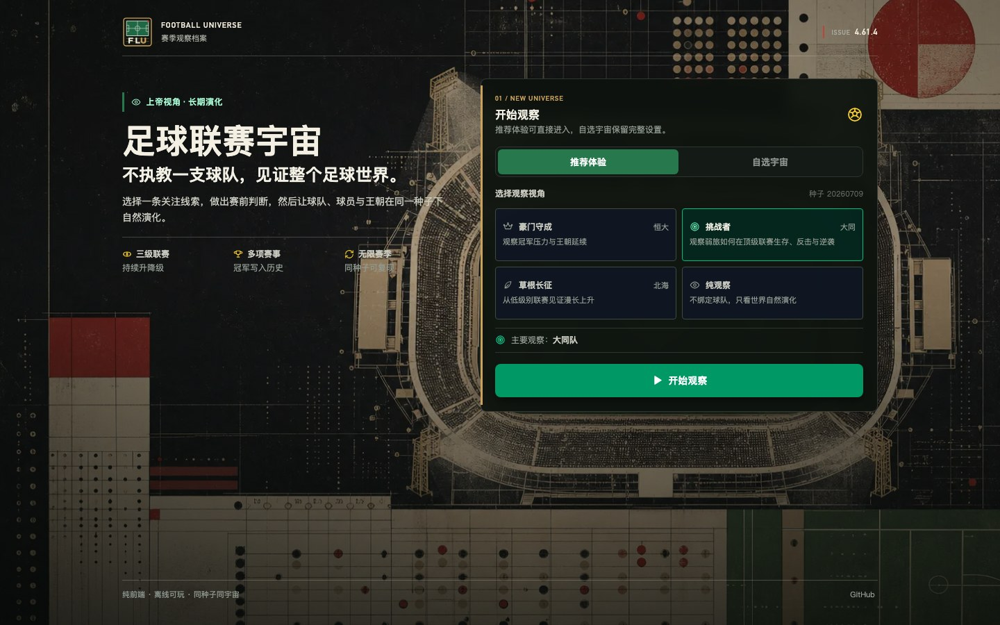
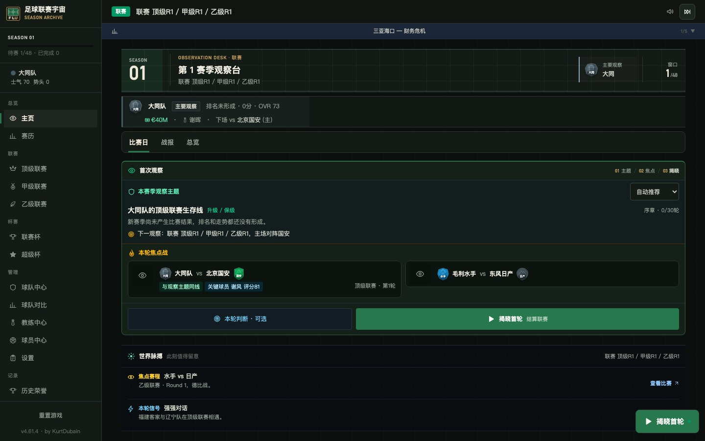
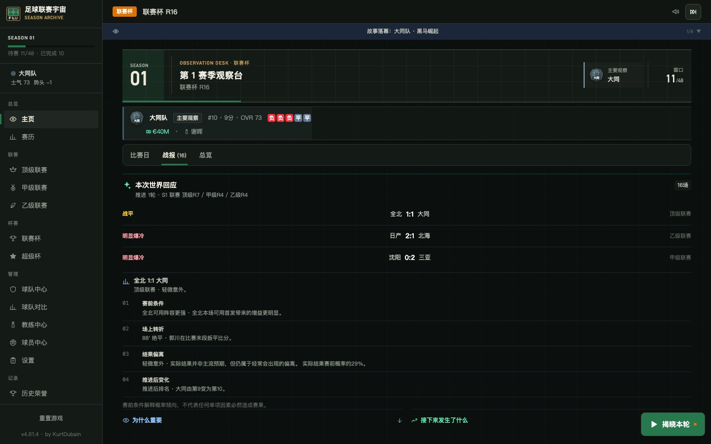
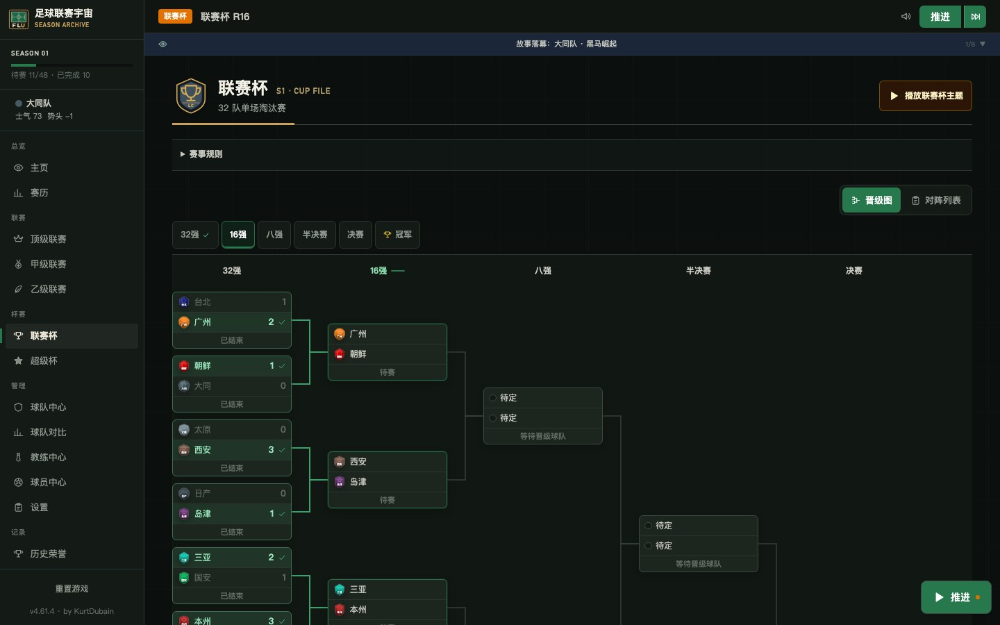
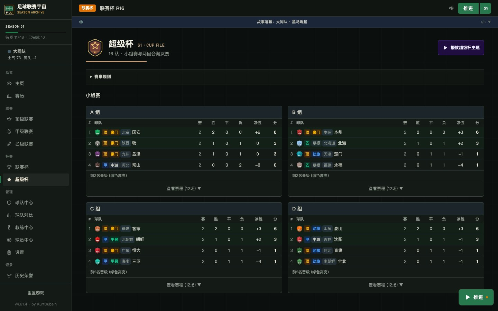
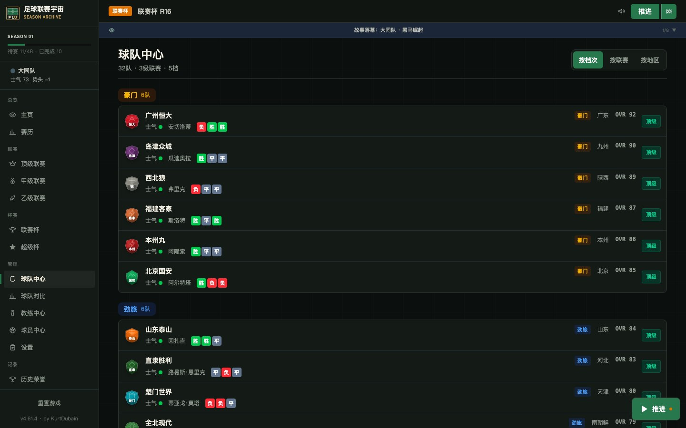
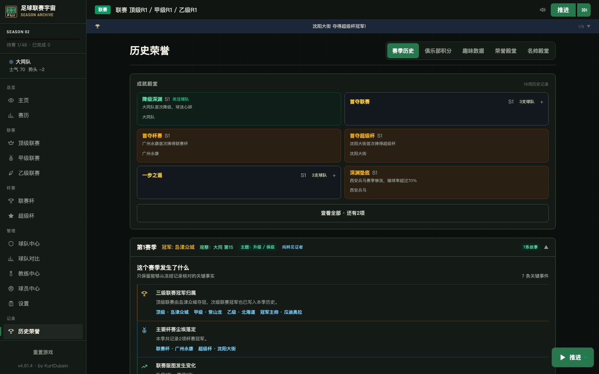
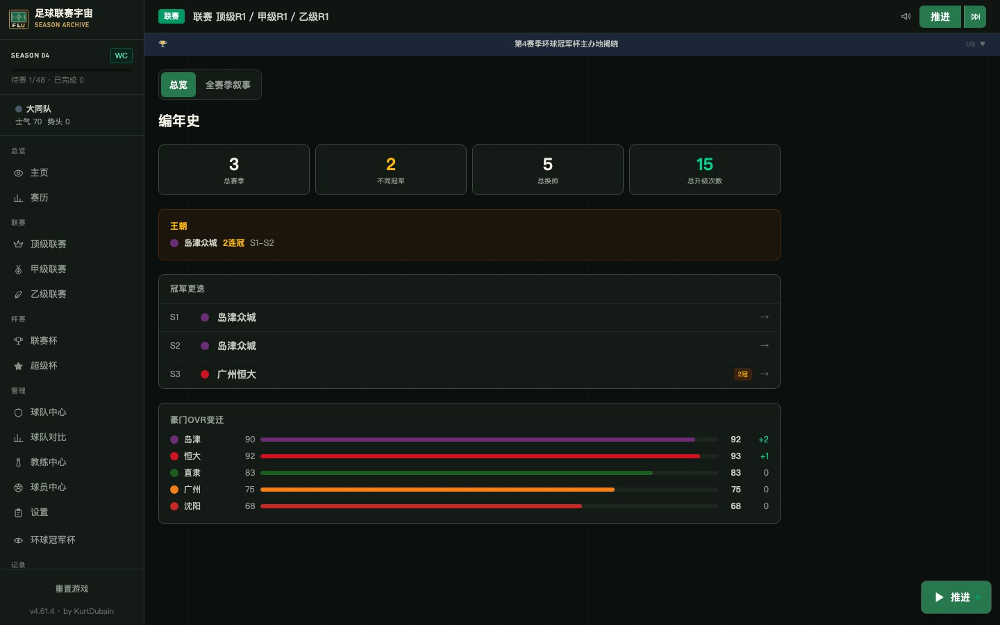
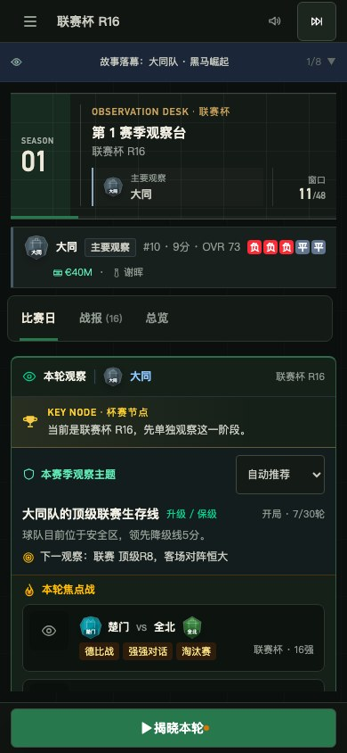

<p align="center">
  
</p>

<h1 align="center">下一季见：足球编年史</h1>
<h3 align="center">从一场球开始，跟一支球队过赛季。</h3>

品牌更名的本地验收与技术身份保留范围见 [品牌说明](docs/brand-rename.md)。下方旧版本截图作为历史演示保留，不代表新品牌最终参赛素材。

个人版与参赛版已分别部署，使用独立构建和存档命名空间，命令与资源边界见 [双版本构建](docs/build-editions.md)。三岸纪预设的人工内容审阅待办保留在内部清单，不代表授权或合规保证。

<p align="center">
  <strong>你不操控比赛 — 你观看整个足球宇宙自动演化</strong><br/>
  <em>You don't play the matches — you watch an entire football universe unfold on its own.</em>
</p>

<p align="center">
  <a href="https://cup.dyp02.vip/"></a>
  <a href="https://github.com/KurtDubain/football-universe"></a>
</p>

<p align="center">
  
  
  
  
  
  
</p>

---

## English Summary

A **pure-frontend, observer-style football simulator** with 32 default clubs, three league tiers and six cup competitions: League Cup, Super Cup, Mainland Cup, Southern Cup, Eastern Cup and World Champions Cup. Cups follow different seasonal schedules. Press "Advance" and witness:

- 🏆 Dynasties rise and crumble across infinite seasons
- 💥 Underdog cup runs and shocking upsets
- 👔 Coaches get fired under pressure, then resurrect at new clubs
- 📰 A deterministic Narrative Director connects causes, turning points, and long-term consequences
- 📈 Team OVR drifts naturally with mean reversion
- 🎲 Seeded simulation — reproduce results with the same version, seed, settings and simulation-affecting choices

**4 game modes**: Free / Epic Dynasty / Underdog Rise / Sandbox (custom teams).
Separately, choose one of **3 guided observer lenses** or a neutral observer view; these are not additional game modes.
**30+ achievements**, season narratives and a multi-season chronicle with bounded detailed history. PWA installation and core offline play are available after the first online load; secondary pages must be visited online before offline reuse.

→ **[参赛版 · 三岸纪](https://cup.dyp02.vip/)** · **[个人版](https://football.dyp02.vip/)** ← (opens in browser, no signup)

---

## 这是什么？

按下「推进」键 — 联赛轮次翻出比分，杯赛冷门上演，教练被解雇，弱队奇迹升级……长期游玩自然生成"历史"和"故事"。关注球队、做出观察判断，再看比赛如何揭晓。

市面上的足球经理游戏都要你买卖球员、排阵型、做决策。**这个项目反其道而行**：你做一个上帝视角的观察者，看着王朝崛起、豪门沉沦、黑马逆袭、名帅下课。

---

## Screenshots | 截图

以下截图来自 **v4.61.4**、推荐种子 **20260709**、自由模式的挑战者视角，均为真实推进生成。历史荣誉展示 S1，编年史展示三季记录。桌面为 1440×900，手机为 390×844。先运行 `pnpm build:audit`，构建完成后运行 `pnpm preview:audit --host 127.0.0.1 --port 4173`，另一个终端运行 `pnpm screenshots` 即可重新生成截图与分享图；自定义端口可设置 `SCREENSHOT_URL`。

<p align="center">
  
  
</p>
<p align="center">
  
</p>
<p align="center">
  
  
</p>
<p align="center">
  
  
</p>
<p align="center">
  
  
</p>
<p align="center">
  
</p>

---

## Features | 核心特性

### 🏟️ 完整联赛体系
三级联赛（16+8+8），双循环赛制，升降级 + 中立场单回合附加赛。冠军/降级实时概率、积分走势折线图、收官之战标签。

### 🏆 杯赛体系
共有六项具名杯赛：联赛杯、超级杯、大陆杯、南洲杯、东洲杯和环球冠军杯，按下表的不同周期举办，并非每季全部举行。

| 赛事 | 赛制 | 频率 |
|------|------|------|
| **联赛杯** | 32队中立场单回合淘汰 | 每赛季 |
| **超级杯** | 16队主客场小组赛 + 两回合淘汰，决赛中立场 | 每赛季 |
| **大陆/南洲/东洲杯** | 区域内全队参赛；俱乐部积分用于分档，中立场3轮小组赛 + 单回合淘汰 | S5起每6赛季 |
| **环球冠军杯** | 32队、轮换东道主、8组中立场3轮小组赛 + 单回合淘汰 | 每4赛季 |

经典淘汰赛晋级图 / 对阵列表切换 · 移动端当前轮自动定位 · 客场进球规则 · 杯赛规则卡 · 9 段原创赛事音乐与跨页面播放会话

### 🎮 4 种游戏模式
- **自由模式** — 默认平衡设置
- **王朝模式** — 顶级豪门更强，王朝难破
- **草根逆袭** — 实力均衡，弱队多冷门
- **沙盒模式** — 配合自定义球队编辑器

开局观察视角另分为豪门守成、挑战者、草根长征三个引导路线，以及不绑定球队的纯观察。视角决定关注起点，不等同于调整模拟参数的游戏模式。

### ⚽ 深度模拟引擎
泊松分布进球采样 + 多因素加权：OVR · 实际首发 · 教练能力 · 自动阵型与策略 · 士气 · 疲劳 · 主场 · 动量 · 德比。弱队通过有代价的低位防守或快速反击应战，不获得隐藏固定补正。世界杯东道主拥有独立赛会氛围，不与普通主场优势混用。**Seeded PRNG**：相同版本、种子、初始配置和影响模拟的操作序列可复现结果；只分享种子不保证不同版本或干预后的世界一致。

### 📺 Canvas 2D 比赛直播
22 名真实比赛阵容球员实时传球跑动 · 四种真实阵型与五种比赛策略 · 焦点球员克制标记 · 高 DPI 固定帧率画布 · 扑救/封堵/射偏定向演出 · 加时与点球阶段 · 可选声音 · 文字解说

### 👔 教练生态
36 名教练 × 5 种风格 × 4 种首选阵型 · 根据实力差、体能与赛事阶段自动选择策略 · 预测/赛果/回放冻结同一部署 · 压力下课 + 合同到期 + 急流勇退 · 名帅殿堂排行榜

### 球星观察
世界焦点完整收录所有达标现役球员 · U23 新星雷达 · 最多关注 8 名球员并跨转会追踪 · 每场直播最多 5 名真实首发焦点 · 四个位置共用本场影响与最佳球员通道，不公开隐藏潜力或额外“球星分”

### 世界叙事导演
比赛日“世界脉搏”以 1 条主故事 + 最多 2 条短信号控制注意力，其余去重事实默认折叠。联赛不败、杯赛巨人杀手、四位置球员近况、换帅反弹、重大转会、争冠升降级、洲际舞台和可靠纪录都来自现有权威数据；“故事脉络”、赛季版图、实体档案线、赛季回顾与历史摘要共用稳定 arc 身份。叙事层不消费模拟 RNG，也不写入或改判比赛结果。

### 📊 长期历史 + 编年史
赛季回顾（含叙事文案）· 历史奖杯榜 · 趣味纪录 · **30+ 成就**（首次类/纪录类/数据类/王朝类/黑马类）· 编年史多赛季回顾 · 跨赛季交手记录。为控制浏览器存档体积，完整交手、球员赛季数据和球队赛季记录分别保留最近 3、25、40 个赛季，奖杯与核心荣誉继续长期累计。

本地人物追溯改进（尚未发布）：上季金球、金靴、最佳后卫和最佳门将延续一季焦点资格，默认十席最多保障四位不同得主，其余席位沿用表现与能力排序。关注人物在新季无数据时展示已知荣誉身份；整季摘要提炼冠军变化、个人成就和球队去向。球员档案最多展示四个关键节点，当前伤停不会被固定历史节点挤掉。退役记录保留最近300人，另为个人奖项得主和关注人物保留精简事实，不再复制俱乐部完整奖杯历史；摘要不等于完整比赛回放，已清理的旧记录不会伪造恢复。

### 🎲 互动元素
赛季预测（冠军/降级）· 每轮观察判断（胜平负/进球区间/爆冷）· 上帝之手（每赛季 1 次球队 buff/debuff）· 手动解雇关注球队教练。预测与判断不消耗资源，也不改变模拟结果。

### 🌍 大洲对抗系统
3 大洲（大陆/南洲/东洲）跨洲赛事统计 · 三层德比体系（巅峰/焦点/地区，OVR动态判定）

### 📱 PWA 离线
首次访问后可安装到桌面 · 核心观察与推进离线可用 · 次级页面在线打开后可离线重访 · 自动安全更新

---

## Quick Start | 快速开始

**在线体验：** **[参赛版 · 三岸纪](https://cup.dyp02.vip/)** · **[个人版](https://football.dyp02.vip/)**。两个站点存档独立，不互相共享。

本地运行：

```bash
git clone https://github.com/KurtDubain/football-universe.git
cd football-universe
pnpm install
pnpm dev      # http://localhost:5173
pnpm build    # 个人版生产构建 → dist/personal
```

> 最低需要 Node.js 22.12，仓库通过 `.nvmrc`/`.node-version` 固定使用 22.22.2，并通过 `packageManager` 固定 pnpm 10.34.5。

---

## Testing | 测试

```bash
pnpm test         # 跑一次（CI 用）
pnpm test:watch   # 监听模式（开发用）
pnpm test:ui      # Vitest UI（浏览器面板）
pnpm lint         # ESLint
pnpm typecheck    # TypeScript strict + 未使用代码检查
pnpm build        # TypeScript + 个人版生产/PWA 构建 → dist/personal
pnpm budgets:check # 入口 JS、CSS、图片与 PWA 预缓存硬预算
pnpm audit --prod # 生产依赖审计
pnpm audit:current # 生产预览的长期数据与浏览器审计
pnpm audit:advance-performance # 移动端推进、重复点击与存档恢复
pnpm audit:animation-performance # 直播逐帧、P95、4x CPU 与暂停恢复预算
pnpm audit:coach-stars         # 战术分布、长期球星供给、MOTM、性能与存档增量
pnpm audit:narrative           # 叙事来源频率、选择平衡、性能与模拟基线对照
pnpm verify:pwa-update         # 远端版本识别与自动更新
pnpm verify:pwa-transition     # 真实旧构建到新构建的 Service Worker 切换
pnpm verify:route-recovery     # 分包失败、慢速网络与离线恢复
pnpm verify:mobile-routes      # 全路由移动端、平板与桌面矩阵
pnpm verify:cup-bracket       # 晋级图、视图切换与移动端杯赛体验
pnpm verify:narrative-director # 世界脉搏、故事脉络、实体线程、总览与历史
pnpm verify:smoke             # 自动构建并运行提交级浏览器回归
pnpm verify:full              # 自动构建并运行每周完整浏览器矩阵
pnpm scripts:check            # 禁止审计脚本依赖个人电脑绝对路径
pnpm audio:check              # 赛事音乐清单、格式、时长与总体积预算
pnpm music:generate           # 在 macOS 上可追溯重建原创赛事音乐
pnpm audit:long-save           # 1/50/100/150 赛季存档恢复与容量
```

---

## Tech Stack | 技术栈

| Layer | Tech |
|-------|------|
| Build | **Vite 8** + **vite-plugin-pwa** |
| UI | **React 19** + **TypeScript 6** |
| State | **Zustand 5** (persisted to localStorage) |
| Styling | **Tailwind CSS 4** |
| Routing | **React Router 7** |
| RNG | Seeded **mulberry32** (deterministic) |
| Rendering | **Canvas 2D** (match live broadcast) |
| Deploy | **Vercel** (static site, CDN edge) |

Current release: **v4.75.0**, **not merged to `main` and not deployed** — it lives on the `feat/youth-balance` branch. https://football.dyp02.vip/ is still serving **v4.73.0** deployed from `main/3ef5bb9` as `v4.73.0-3ef5bb9-20261117` (switched 2026-11-17 23:53 Beijing time — the round that shipped six versions at once, v4.68.0 through v4.73.0), with `v4.67.0-18c3e76-20261117` retained as `previous` for rollback; https://cup.dyp02.vip/ remains on **v4.61.11** and is deliberately not upgraded. v4.75.0 is the round that answers a playtest of v4.74.0 — the running does not read as running, the stand is inaudible under itself, an ordinary pass makes no sound, and the keeper stands outside their own goal. Seven parts. **A sprinting footballer swings their legs.** Figure motion was normalized against 0.0055 of the pitch per frame, which is 34.6 m/s, while the movement layer tops a forward out at 17.5 — so the amplitude saturated at 0.32 and a ten-pixel player at full sprint swung its legs 0.65 px, narrower than the line the leg is stroked with. The reference is now 17.5 m/s, so a full sprint sits at the top of the range and a midfielder's 6.2 m/s jog at six tenths of it. **Cadence follows pace.** The stride was a flat 0.44 rad per frame — 4.2 cycles a second, eight steps — whether the player was walking or sprinting; a cycle is two steps, so it now runs from 1.1 Hz to 2.3 Hz, and the phase is integrated by the caller because a rate derived from a speed that changes every frame would snap the legs on every change. **The legs stop scissoring sideways.** The torso already narrowed by facing and the legs did not, so a player running at the lens still chopped across the screen; the lateral component now scales with the profile and the depth component — the near foot rising in frame — takes over as the profile goes to zero, and the foot lift is scaled off the swing itself rather than a flat 0.24 that lifted a ten-pixel player 0.16 px. **The stand is no longer clipped by its own volume.** The chant's voice track was written straight to a peak of 1.07 before any gain, and the stadium profile multiplied that by 1.36 and the master by 1.06, so the bus peaked at 2.85 (+9.1 dBFS) and the compressor spent the match pulling about 20 dB out of it; the four layers are now peak-normalized to declared values and the bus carries a headroom trim that puts the worst case at 0.78. **The stand is audible under the chant.** The bed topped out at 0.087 against the chant's 1.36 — 21.6 dB apart, which is not a balance but a missing layer; the two now sit between 8 and 18 dB apart, checked against the real buffers rather than inferred from the gains. **An ordinary pass makes a sound.** Contact cues only fired for shots and set pieces, and an ordinary pass is not a match event and carries no scene, so a possession sequence played out in silence; every pass now synthesises a strike at its contact frame, scaled by the distance and by the speed the model gave the ball, so a five-metre lay-off is a dull knock and a thirty-metre switch is brighter and harder, both well under a shot. An open-play free kick whistles now too — the cue read the raw `playOrigin`, which an open-play free kick does not carry. Audio nodes stop leaking: a fresh stereo panner was built per cue and never disconnected against a context that is never closed, and `stop()` took down only two of the seven buses, so closing a match and opening the next stacked a second copy onto the same output. **The keeper stays in the goal.** Half the mouth is 3.66 m; the clamps ran to ±5.44 m in one place, ±3.4 m in another and not at all in a third, and a shot 8.8 m wide could pull the keeper 25 m off the middle of the pitch. One span now governs all three — ±4.2 m, half a metre outside the post, which is what narrowing the angle actually looks like — and a shot going wide leaves the keeper in the frame with the dive visibly short. **A degraded renderer no longer plays the animation at half speed.** Particles, camera shake, the goal flash, ball spin, trail sampling, dead-ball timing, camera easing and every pulse advanced once per rendered frame while player positions were already scaled by the frame step, so at 30 fps the ball kept real time and everything around it slowed down. They now read one wall clock accumulated from the frame step; measured over the same two seconds, 120 frames at 60 fps and 60 at 30 cover the same ground, where the old integrator covered half. **The ball's highlight stopped orbiting** — it is the light, not the ball, and inside the rotation group it read as a sixth panel — **and a lofted ball now lands and skips** rather than arriving dead: it touches down at 76% of the flight and bounces at 0.42 restitution into the target, so the higher it went the further it carries, while a driven ball keeps the curve it always had. A zoom director that had never executed was deleted: framing belongs to the rig system, and the render loop parks the legacy camera at the centre of the canvas at 1x every frame, so the 1.004-to-1.72 table, its easing and its focus weights never ran. SAVE_SCHEMA_VERSION stays at 26, no save field was added or renamed, and this round consumes no simulation randomness, so a seed reproduces exactly the universe it produced on v4.74.0. Evidence is 1,673 unit tests across 195 files — up from 1,664 — with new guards that fail unless a full sprint swings the legs at least 0.18 of the drawn height (the old constant measured 0.064), a runner coming at the lens has under 0.02 of lateral swing and over 0.05 of foot lift, the chant bus stays inside full scale, the bed sits 8-18 dB under it, a short touch is duller and quieter than a long one, a shot inside the frame is reachable while one going wide leaves the keeper in the goal, a lofted ball touches down before its target and skips, and 30 fps covers the same ground as 60. v4.74.0 is the round that answers a playtest of v4.73.0 — the ball is slow, and it is slow in a way that has nothing to do with how far it travels. Three parts, all measured over 300 generated attacks. **A goalscoring move is played at a football tempo.** Every pass inside a move ran at a flat 17 m/s, a training-ground pace, and once re-aiming was applied the median across the whole match measured 13.3 m/s. Pass speed is now a property of the pass: a four-metre lay-off is rolled, a thirty-metre switch is driven. Median pass speed is 20.5 m/s, with 10-25 m passes at 20.9 and 25-40 m at 24.5, against real football's 12-16 for a short pass, 18-24 for a medium one and 22-28 for a long one. **The most urgent football is no longer the slowest thing on the pitch.** The move that ends in a shot used to run at a median of 12.8 m/s while the ordinary circulation around it ran at 22.1 — an inversion a viewer feels before they can name it. It is now 20.9 against 19.8. **A re-aimed pass is no longer left crawling.** Flight time was only ever lengthened, never shortened, so a pass re-aimed at a receiver who had dropped back kept the flight time of the longer planned ball: passes under ten metres travelled at a median of 3.9 m/s with a 5th percentile of 1.4, which is a ball being pushed along the grass. Flight time is now derived from the distance the ball actually travels, in both directions, using a speed ceiling carried on the phase rather than a guessed one. Passes under ten metres are back to a median of 11.9 m/s and the 5th percentile across all passes rose from 1.4 to 7.1. A cross is lofted, so it covers the ground slower than a driven ball, but it is no longer slower than a ground pass: 22 m/s rather than 13, which takes the delivery to a median of 25.7 from 12.3. Shot speed is unchanged at 28 m/s, and a header at 19. SAVE_SCHEMA_VERSION stays at 26, no save field was added or renamed, and this round consumes no simulation randomness, so a seed reproduces exactly the universe it produced on v4.73.0. Evidence is 1,664 unit tests across 193 files — up from 1,663 — with one new guard that replays eighty attacks and fails unless the move's median pass speed is above 18 m/s, is at least nine tenths of the circulation's, a pass beyond 25 m is more than 6 m/s faster than one under 10 m, and no pass in the slowest five percent is below 6 m/s. On the old model that guard measured 12.6 m/s and failed. This round also carries a production-bundle playtest: two full matches were watched to the ninetieth minute on the built personal bundle (岛津众城 3:0 大同队, and 北京国安 against 全北现代), and the live canvas was sampled pass by pass for the distance the ball actually covers. Forty-three passes measure a median on-screen speed of 14.6 m/s; the broadcast plays at a 0.72 motion rate, so that is a physical 20.3 m/s against the model's 20.5. On screen the passes grade by distance at a median of 7.7 m/s under ten metres, 15.8 between ten and twenty-five and 21.8 beyond (21 / 15 / 7 sampled passes, so the long band is thin). The render held the full tier for 3,867 frames at 0.87 ms with zero console warnings, zero console errors and zero failed or 4xx/5xx requests. v4.73.0 is the round that answers a playtest of v4.72.0 — the moves still read as fake, shots came out of nowhere, and the ball crossed the pitch faster than a ball can travel — in four parts. **The striker runs into the box.** The shooter had no target of their own for the whole build-up: they received nothing until the last pass, so they held a formation slot for eight passes and then had half a second to cover thirty metres. Measured on a real replay, the shooter stood 20-31 m from the release point at the moment of the strike. The striker now runs at the strike point from the first pass — never more than 23 m ahead of the ball, never past the point the chance is struck from, drifting onto the strike lane as the ball enters the last thirty metres. On the same replay the shooter is now a median of 4.3 m from the release point and at worst 4.6 m. **The ball is struck from where the striker is.** The shot origin used to be held inside a 0.72-0.94 band, so a striker who had not made the run had the ball struck seventeen metres in front of them: in the 45th minute of the sampled match the shooter stood 46 m out and the ball left from 29.4 m. The band is gone. The release point is always within 5.25 m of the shooter, and the band is no longer needed to keep the chance worth taking because the striker now arrives. All six shots of that replay land between 12.1 m and 24.6 m, median 18.0, where three of them had been at thirty. **A long pass takes the time a long pass takes.** Flight time was derived from the planned distance and never recomputed when the pass was re-aimed at the receiver's live position, so a ball planned at twelve metres flew fifty-eight in forty-two frames — eighty-two metres a second — and the replay's passes measured p95 45.3 and max 82.3 m/s. Re-aiming now recomputes the flight from the new distance, the receiver is preferred among teammates within 38 m rather than whoever stands nearest the waypoint, and open-play flight time is derived from real metres instead of a normalized ramp capped near ninety frames: ordinary passes keep their tempo, and past thirty metres the ball slows towards a launched ball with a 2.2 s ceiling. The same replay now measures p95 27.1 and max 35.2 m/s. **A striker sets themselves before striking.** The run-up was a flat fourteen frames, a quarter of a second, so the ball left the foot the instant it arrived; it is now 26-36. The sampled match runs 249 s against 235 s, the growth almost entirely in long passes that now take the time they should, and the render stayed at the full tier for all 45 samples. SAVE_SCHEMA_VERSION stays at 26, no save field was added or renamed, and this round consumes no simulation randomness, so a seed reproduces exactly the universe it produced on v4.72.0. Evidence is 1,663 unit tests across 193 files — up from 1,661 — including two new guards: one that replays forty whole attacks and fails if the shooter is more than 6 m from the release point or the shot is struck from beyond 30 m, and one that replays sixty whole attacks and fails if any pass implies more than 40 m/s. v4.72.0 is the round that makes the players move like footballers, in seven parts. **The shooter no longer teleports.** The carrier used to be clamped inside a 2.6 m radius of the release point the instant the ball left the foot, while the run-up was only 20-28 frames (0.4 s) — the shooter was standing up to 19.9 m away and could not get there, so the clamp is what moved them: 200 of 200 shots teleported the shooter, on the most visible frame of the match. The clamp is gone and the shooter walks to their release point; peak single-frame displacement fell from 19.915 m to 0.161 m. **Players run at a footballer's pace.** The role table specified a 23.9 m/s cruise for a forward, 63 m/s at full sprint and 174 m/s² of acceleration — six times a sprinter, reaching top speed in 0.14 s where a person needs 2.1 — and over 2.0M player-frames 36.6% exceeded 11 m/s with a 99th percentile of 34.5. Speeds are now real jog values (forward 6.2, defender 5.6, keeper 3.4 m/s) that the sprint boost carries to 9.6 / 8.7 / 5.3, acceleration is 4.4 m/s², and the directed-recovery boost fell from 1.7 to 1.15; measured p50 2.12, p95 6.10, p99 7.82, max 9.67 m/s, with 0.00% of frames over 11. **The ball is passed to whoever is actually standing there.** The directed route picked its receiver by formation slot — a position on a diagram, not on the pitch — while the tactical shape had moved that player a long way during the possession, and the target was a point on a curve with no relation to them: 95.7% of passes demanded more than 11 m/s from the receiver, median 37. The receiver is now chosen by live position, the ball is aimed at their feet with at most 2.5 m of lead, and the creator's entry point is held inside a run; required speed is now median 2.04, max 6.75 m/s, with 0.0% of passes unreachable. **A pass is re-aimed as it is played.** The route is planned once when the possession starts but the players keep moving, so by the fifth pass the target can be fifteen metres from where the plan assumed; each pass now re-aims at the receiver's live position at the moment of release, which moves only where the ball goes and never who plays it — that step alone took unreachable passes from 30.4% to 0.0%. **Flight time follows the real distance.** Every pass used to take 25-45 frames whether it travelled 5 m or 30; it is now derived from 17 m/s along the ground (13 for a cross), with a 15-frame floor and a 96-frame ceiling, computed in metres because the pitch is 105 by 68 and the two normalized axes are not the same distance. A goalscoring move is still 8-10 passes with a median of 9 and no self-passes. **The ball has to go forward.** Aiming it at the receiver's feet without asking where those feet are pointed made a nine-pass move spend itself in its own half: the receiver was picked as the slot nearest the planned target, and once the tactical shape had dragged the whole team back the nearest slot was a defender, so the ball circulated between 16 m and 54 m without advancing and a shot was then struck from 76 m with the ball last seen at 37 m. A receiver must now be ahead of the ball — a three-metre lay-off is tolerated, more is not — the carry is aimed forward, and the receiver is re-chosen from all eleven live positions at the moment the pass is played. The two passes the event names keep their receiver, because those are facts and not choices. Measured over 300 attacks: net advance median 56.5 m (p05 51.2), back-passes median 0 and at most 1, and a representative move now reads 36 → 39 → 59 → 58 → 59 → 65 → 73 → 80 → 84 m. In the browser, a home move ran 0.46 → 0.59 → 0.76 → 0.85 and was struck from 9.2 m, and an away move ran 0.63 → 0.52 → 0.41 → 0.26 → 0.20 → 0.08 and was struck from 7.9 m into the goal. **Shots are struck from where a striker stands, at a footballer's speed.** The shot origin used to be held inside a run the shooter could make, but the route was generated while the shooter was still on a formation slot some 52 m away, so the origin was dragged back to them and then pinned to the bottom of the shooting range: every shot in the match was struck from 39.9 m. Flight time was a fixed 26-40 frames regardless of distance, which sent the ball off the boot at a median of 111 m/s where a real strike is 25-33. The origin is now held inside the shooting range (0.72-0.94 of the pitch) instead of being pulled back to a shooter who is not there yet, and flight time follows the distance at 28 m/s for a strike and 19 for a header. Measured over the same 300 attacks: origin median 14.7 m from the goal line (p95 18.7), ball speed median 28.0 m/s (p95 30.2), and the shooter stands a median of 3.49 m from the release point with 0.3% beyond 6 m, where before it was 31.1 m and 100%. One attack is now 956 frames — 15.9 s at 60 fps, p95 1,047 frames / 17.5 s — up from 10.4 s, because the ball now actually crosses the pitch. A 3-0 replay measured 235 s end to end against 174 s before, and the growth is entirely inside the goal build-ups: routine minutes are unchanged at about 1.6 s and the render stayed at the full tier for all 53 samples of the run. SAVE_SCHEMA_VERSION stays at 26, no save field was added or renamed, and this round consumes no simulation randomness, so a seed reproduces exactly the universe it produced on v4.71.0. Evidence is 1,661 unit tests across 193 files — up from 1,654 — including four new guards: one that fails if any player exceeds 12 m/s or moves more than 0.5 m in a single frame, one that replays forty whole attacks and fails if any pass asks a receiver to outrun a footballer, and one that replays forty whole attacks and fails if the ball does not advance at least 25 m or is played backwards more than once. v4.71.0 is the round that gives a goal a build-up, in three parts. **A goalscoring move is eight to ten passes**: the directed route was hard-wired to three players — the man on the ball, the creator, the shooter — so every goal in the broadcast arrived after two passes and about a second of football; the move is now a build-up leg of six to eight passes generated from waypoints (the ball runs along a quadratic toward the chance area, dipping back into midfield first when it is already in the final third, with three lateral shapes — a switch of play, a wing overload, a central combination — and the receiver picked as the nearest non-repeating outfield slot) followed by the two passes the event names, and over 3,000 generated sequences it measures 8 passes at the floor, 9.00 on average and 10 at the ceiling, with zero self-passes and the creator and shooter identities preserved 3,000 times out of 3,000. The simulation does not record how a chance was constructed, so the length of the approach is a presentation choice and rewrites no result. **The wait before the shot is gone**: a scene used to be prepared up to five minutes early, so the move played out, ran out of phases and then sat on its hold frame for about 2.6 s until the clock reached the goal; the lead is now zero and the scene starts on the event minute, which is the minute the playback clock stops at anyway, so the attack runs, the outcome lands and the score changes in one breath — and because no scene can be returned for a minute before its own event, the wait branch of the clock gate is structurally unreachable. **A minute of football is worth its time again**: a quiet minute was 430 ms, which advanced the canvas eighteen frames — half a pass — so a passage of play took three minutes of match clock to cross the screen; it is now 1,150 ms, the four routine beats were raised with it (corner 1,580, foul 1,480, save 1,400, shot off target 1,300, every one of them longer than silence), and the 720 ms approach-a-shot slowdown was removed — it was a crutch for a two-pass attack that no longer exists, and it was suppressing the round-one routine timeline for thirty of the ninety minutes. Measured full-match length: 173.7 s in 完整 (median 173.9, p95 212.2), 237.7 s in 沉浸 and 53.8 s in 精华, with an ordinary minute landing between 1.13 and 1.65 s. v4.70.0 is a broadcast-pacing round on top of v4.69.0, in two parts. **The quiet minutes are filled from the simulation's own totals**: the live feed only ever played the subset of events worth reporting, while the simulator had already tallied the whole match — fouls, corners, shots, shots on target — so the ordinary football between the highlights was skipped whole; `buildRoutineTimeline` subtracts what the event feed already accounts for from each authoritative total and lays the remainder on the clock, capped at 62% of minutes so quiet stretches still read as quiet, and the same match now prints 11 commentary beats where it printed 4. A foul is the one beat that stops play: the whistle pins the ball and only the players near enough to have an opinion gather into a ring around the referee, then release before the free kick. **The ball stops flying**: pass height used to be a step function of distance — under 34 m a pass topped out at 0.44 of a drawn player's height while the next metre started at 1.34 and reached 2.32, two bands that did not overlap at all, and 31–47% of passes crossed that line — so height is now a property of the pass instead, with a ceiling per pattern (counter 0.24, central combination 0.28, recycle 0.3, wing overload 0.7, build-up 0.9, switch of play 0.95) that distance climbs towards continuously; measured over 11,314 generated phases, the same 44 m ball now peaks at 0.69 of a player as a counter and 1.91 as a switch of play, where before the two were identical. Flight time follows the same continuous curve (47 to 84 frames measured) instead of stepping between two bands whose medians differed by 59%, and a ball cut out at the top of its arc now keeps its remaining height and settles instead of dropping — the highest interception fell from 2.29 players to 0.41. v4.69.0, the round underneath it, is a presentation-and-audio round on top of the v4.67.0 engine, in six parts. **Neutral venues are actually neutral**: two reads were missing — the fixture prediction card never consulted the neutral-venue flag, and the live canvas never received it — so the full club-home dressing (nine stand blocks in the home colours, one tifo, a centre-circle crest, home corner flags) was drawn at neutral grounds too; a neutral pitch now splits the stand 4/1/4 between the two sets of fans with two facing tifos and leaves the centre circle and the corner flags bare, a World Cup host still takes the larger block but still gets no centre-circle crest, and the goal wash takes the scoring side's colour. **One palette**: the same "danger red" carried four different hex values across the app, because colour was written per call site; the palette is now one set of semantic tokens (eight hues, a brass gold, a neutral ramp) that 3,630 colour references across 66 files resolve to without a single call-site edit, with five flattened categorical chart ramps restored. **The crowd chants in time**: the chant layer is now four synthesised layers — sparse applause, dense applause, a low-frequency drum anchor and heavily filtered distant voices — each behind its own threshold (0.42 / 0.56 / 0.64) driven by live intensity, all Web Audio, no third-party samples. **Ceremony**: five new ceremonies (season opening, season closing, cup-final stamp, World Champions Cup opening and closing) in an almanac-print language — paper grain, page turn, CMYK misregistration, stamp, foil — where the cup stamp passes through in 1.4 s and the season and World Cup ones hold until dismissed; seen state is per save in session storage, and the component with its stylesheet is lazy-loaded, so none of it is in the first paint. **A league bed**: the season desk, calendar and league routes now carry their own bed (92 BPM, 16 bars, 41.8 s) that plays only inside a season window, yields to the match soundscape on entering a live match, and fades out after ten idle minutes; the eight tournament fanfares are untouched, so the manifest is nine tracks. **Cards get a camera**: yellow cards, red cards and substitutions previously existed only as a line of text in the timeline; they now cut to a flat printed card at the near touchline for up to 108 frames (1.8 s at 60 fps) and step aside when a shot falls in the same or the next minute. Commentary no longer invents: three phase beats ("contesting midfield control", "the tempo settles", "fitness and shape start to tell") had no counterpart in the simulation, and every phase beat printed 0:0; they now state the real scoreline at that minute. Three byte budgets moved, each with its reason recorded in the source: PWA precache entries 89 to 90 (the ceremony lazy boundary makes React a shared chunk), the CSS cap 194,560 to 197,000 (the ceremony stylesheet rides the lazy chunk, but the checker sums all CSS), and the audio total 2.8 to 3.2 MB (the league bed is 368 KiB and is never precached). SAVE_SCHEMA_VERSION stays at 26, no save field changed, and this round consumes no simulation randomness, so **a seed produces the same universe it produced on v4.68.0 and on v4.67.0**. Evidence is 1,660 unit tests across 193 files — up from 1,514 across 182 in v4.68.0 — plus typecheck, lint, the docs / changelog / scripts / audio checks, and the production build with its byte budgets. A production-bundle playtest ran in a desktop browser against `vite preview` on `dist/personal` with zero console warnings or errors: the season-opening ceremony renders and dismisses, a neutral-venue cup match draws a bare centre circle with two facing tifos where a home match draws a crest and one tifo, the fixture card prints 中立场, phase commentary beats state the real scoreline at their minute, the camera cuts between the tactical and sideline rigs (far touchline row measured at 0.191 and 0.272 of canvas height, matching the rig table exactly), and the league bed loads its own track while no cup theme is fetched during a league window. The 1.8 s card beat was not caught on screen and rests on its unit tests. **No real-device playtest has been done at any point in this line.**

82k+ production TypeScript lines · 310+ production source files · 190+ test files · 45+ browser/simulation audit commands

当前版本状态、有效待办与明确不做项统一记录在 [`docs/current-status.md`](docs/current-status.md)。旧阶段清单保留为实施与验证台账，不再作为现行任务来源。

生产依赖审计结论与运行边界记录在 [`docs/security-audit.md`](docs/security-audit.md)。

现行“东亚足球年鉴 × 现场转播台”美术语法与图片使用边界记录在 [`docs/art-direction.md`](docs/art-direction.md)。

参赛打磨的历史实施台账与人工走查模板保留在 [`docs/contest-final-polish-checklist.md`](docs/contest-final-polish-checklist.md)。

<details>
<summary>📁 Project Structure</summary>

```
src/
├── engine/           — Pure simulation logic (UI-agnostic)
│   ├── match/        — RNG, Poisson sampling, simulator, events, prediction
│   ├── season/       — Calendar builder, season manager, post-match, season-end
│   ├── standings/    — League tables, schedules, promotion/relegation
│   ├── cups/         — League Cup, Super Cup, regional Continental Cups, World Cup
│   ├── coaches/      — Coaching effects, pressure, hiring, contracts
│   ├── players/      — Player generation, stats tracking
│   ├── observation/  — Read-only Narrative Director, observer themes, trajectories
│   ├── honors/       — Trophy tracking
│   ├── achievements.ts — 30+ unlockable achievements
│   └── events.ts     — Random season events
├── config/           — Game data (teams, coaches, derbies, balance)
├── types/            — TypeScript type definitions + game modes
├── pages/            — Route pages (Dashboard, League, Cup, Chronicle...)
├── components/       — Reusable components (MatchLive, SeasonReview...)
└── store/            — Zustand state management
```

</details>

---

## Roadmap | 路线图

- [x] 自定义球队编辑器
- [x] PWA 离线支持
- [x] 编年史与赛季叙事
- [x] 30+ 成就系统
- [x] 玩法模式（王朝/草根逆袭/沙盒）
- 完整英文 i18n 尚未完成，仅在明确发行需求下评估，不属于冻结阶段待办。
- [x] 球员名字系统（稳定 UUID + 姓名 + 号码）
- [x] 转会系统
- [x] 球员成长 & 退役
- [x] 俱乐部分段球员统计（转会前后贡献拆分）
- [x] 赛季观察档案 PNG 分享图
- [x] 可追溯世界脉搏与跨页面故事线

---

## Contributing | 贡献

欢迎任何形式的贡献！Issues、PR、功能建议、bug 报告都可以。

```bash
pnpm install    # 安装依赖
pnpm dev        # 启动开发服务器
pnpm build      # 检查构建是否通过
```

代码风格：TypeScript strict, 函数式组件, Zustand for state.

---

## Changelog

<details>
<summary>展开查看完整日志</summary>

### Latest
- 世界脉搏 + 结果因果链 + 赛季版图 + 实体档案线
- 联赛不败、杯赛巨人杀手与球员/教练/转会/赛事派生信号
- 4 游戏模式 + 球队编辑器 + PWA 支持
- 30+ 成就系统 + 解锁动画
- 编年史多赛季回顾 + 叙事文案生成
- 球员关键先生指标 + 教练战术分析
- 跨赛季 H2H 交手记录
- 大洲对抗系统 + 三层德比

### v3.1.0
- 设置页改造：游戏内指南、关注球队切换、历史统计
- 修复：WC 小组赛 competitionType, 教练压力多场处理

### v3.0.0
- 首次完整版本：3 级联赛 + 4 项赛事 + 32 球队
- Canvas 2D 比赛直播引擎
- 教练/球员/德比/成就基础系统

</details>

---

## License

[MIT](./LICENSE) — free to use, modify, distribute. Built with ❤️ as a personal weekend project.

---

<p align="center">
  <a href="https://cup.dyp02.vip/">🎮 参赛版</a> · <a href="https://football.dyp02.vip/">个人版</a> ·
  <a href="https://github.com/KurtDubain/football-universe">⭐ Star on GitHub</a> ·
  <a href="https://github.com/KurtDubain">by KurtDubain</a>
</p>
<p align="center">
  <sub>Built with React + TypeScript + Canvas 2D + Zustand + Tailwind + Vite PWA</sub>
</p>
